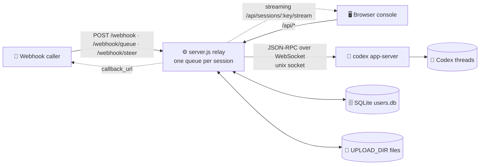
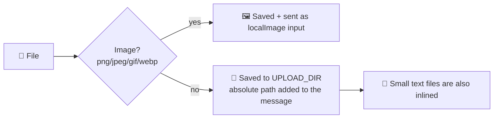

<p align="center"></p>

<h1 align="center">💬 linebot-relay</h1>

<p align="center"><b>Connect webhooks and a web console to your existing Codex threads: read messages, send messages, nothing more.</b></p>

<p align="center">
  <a href="README.md">简体中文</a> · <b>English</b>
</p>

<p align="center">
  
  
  
  
  
  
</p>

---

## ✨ Features

- 🔗 **Existing Codex threads only**: the console and webhooks never create Codex threads; unknown IDs get a 404
- ⚡ **Live streaming**: replies, reasoning and command output are pushed as they're generated (streamed HTTP + 15s heartbeat, 3s polling fallback)
- 🔄 **Refresh-safe**: the URL carries `#s=<session>`, so a reload lands back on the session and a running turn keeps streaming, marked "运行中" (running)
- ⏹️ **Stop button**: interrupt the running turn via app-server `turn/interrupt`
- 🚦 **Queue / steer**: while the AI is busy, choose 排队 (queue: send after the current turn) or 引导 (steer: inject into the running turn with `turn/steer`)
- 📎 **Any file type**: images go to Codex as image input; other files are saved on the server and their absolute paths are passed to Codex. Drag & drop, paste and multi-select supported
- ⬇️ **Download chips**: attachments in the history render as file chips with signed download links
- 🪝 **Three webhooks**: `/webhook` (`mode` param), `/webhook/queue` (always queue), `/webhook/steer` (always steer), all accepting multipart file uploads
- 👥 **Users & permissions**: SQLite-backed; the super admin decides who sees which sessions
- 🖼️ **Images**: AI-generated images shown via signed URLs, click to zoom
- 📝 **Markdown**: marked + DOMPurify
- 🔔 **Async callbacks**: webhooks can pass a `callback_url` to receive the result
- 🌗 **Vue 3 console**: light/dark themes, mobile friendly
- 🪶 **Zero npm deps on the backend**: built-in Node 22 modules (`node:sqlite`), `better-sqlite3` as an optional fallback

## 🏗️ Architecture



## 🚦 Queue vs steer

| Mode | 🧵 AI idle | 🏃 AI running a turn |
|---|---|---|
| 📥 **Queue** `queue` (default) | Sent right away as a new turn | Waits in the session queue, sent in order after the current turn |
| 🧭 **Steer** `steer` | Jumps to the head of the queue, sent right away | Injected into the running turn via `turn/steer` (with `expectedTurnId`) |

- 🛟 **Fallbacks**: if there is no running turn, or Codex rejects the steer, the message is sent next from the head of the queue and the response carries `steer_fallback` (`no_active_turn` / `steer_rejected`)
- 🗂️ Queued messages are listed in the console and can be withdrawn before they're sent (normal users only their own)
- 🔁 Whoever started the running turn (console, webhook or the Codex app itself), queued messages wait until the thread is idle

## 📎 File uploads



- 🖱️ Console: paperclip button, drag & drop onto the window, or `Ctrl/⌘+V` paste
- 🪝 Webhook: `multipart/form-data` (field `file` or `files`), or JSON `files: [{name, content_base64, mime}]` / `file_urls: [...]`
- 📏 Default limits: **50 MB** per file, **10** files, **100 MB** total (see environment variables)
- 🔏 Attachments in the history show as file chips, downloaded through short-lived signed links

## 🔐 Roles & permissions

| Capability | 👑 Super admin | 🙋 User |
|---|:---:|:---:|
| Link an **existing** Codex thread | ✅ | ❌ |
| Delete a session (console record only, Codex untouched) | ✅ | ❌ |
| Assign sessions to users | ✅ | ❌ |
| Manage users, reset passwords | ✅ | ❌ |
| View webhook token / global stats | ✅ | ❌ |
| Read assigned sessions, send messages, upload files | ✅ | ✅ |
| Queue / steer / stop turns (assigned sessions) | ✅ | ✅ |
| Withdraw queued messages | ✅ all | ✅ own only |
| Change own password | ✅ | ✅ |
| Create threads in Codex | 🚫 | 🚫 |

> 💡 Unassigned sessions return 404 to normal users, as if they didn't exist. `WEBHOOK_TOKEN` has admin rights and doubles as an emergency console login.

## 🚀 Quick start

```sh
# 1️⃣ Requirements: Node 22+ and a running codex app-server
git clone https://github.com/dylantsai-dev/linebot-relay.git
cd linebot-relay

# 2️⃣ Configure
cp .env.example .env      # set at least WEBHOOK_TOKEN

# 3️⃣ Build the console
cd web && npm ci && npm run build && cd ..

# 4️⃣ Run
set -a; . ./.env; set +a
npm start                 # http://127.0.0.1:8790/console
```

On first visit with no admin yet, log in with `WEBHOOK_TOKEN` and create one (or seed it with `ADMIN_USERNAME` / `ADMIN_PASSWORD`).

## ⚙️ Environment variables

| Variable | Default | Description |
|---|---|---|
| `WEBHOOK_TOKEN` | — **required** | Webhook bearer token, also the super-admin key |
| `PORT` | `8790` | Listen port |
| `HOST` | `127.0.0.1` | Listen address |
| `CODEX_APP_SERVER_SOCK` | — | codex app-server control socket |
| `CODEX_HOME` | `/root/.codex` | Codex data dir (thread checks, images) |
| `CODEX_BIN` | `/root/.local/bin/codex` | Codex CLI path |
| `CODEX_MODEL` | — | Model override (optional) |
| `CODEX_TIMEOUT_MS` | `600000` | Per-run timeout |
| `MAX_CONCURRENCY` | `2` | Global concurrency cap |
| `MAX_FILE_BYTES` | `52428800` (50 MB) | Max size per file |
| `MAX_FILES` | `10` | Max files per message |
| `MAX_TOTAL_BYTES` | `104857600` (100 MB) | Max total file size per message |
| `DATA_DIR` | `/opt/linebot-relay/data` | Sessions, history, user DB |
| `WORK_DIR` / `LOG_DIR` / `UPLOAD_DIR` | `/opt/linebot-relay/{work,logs,uploads}` | Work, log and upload dirs |
| `USERS_DB` | `$DATA_DIR/users.db` | SQLite user DB path |
| `SQLITE_DRIVER` | auto | Force `node:sqlite` or `better-sqlite3` |
| `ADMIN_USERNAME` / `ADMIN_PASSWORD` | — | Seed the first admin (ignored once one exists) |
| `CONSOLE_DIST` | `web/dist` | Built console directory |
| `CONSOLE_UI` | — | Set to `legacy` for the old single-file console |

## 🛣️ API

| Method | Path | Auth | Description |
|---|---|---|---|
| `POST` | `/webhook` | Token | Send to a session, `mode` = `queue` (default) / `steer` |
| `POST` | `/webhook/queue` | Token | 📥 Always queue |
| `POST` | `/webhook/steer` | Token | 🧭 Always steer |
| `POST` | `/api/send` | Login | Console send; `async=1` returns 202 at once (`id`, `status`, `position`), then follow the stream |
| `GET` | `/sessions` | Token | Session list (legacy) |
| `GET` | `/health` | Public | Health check |
| `GET` | `/api/auth/status` | Public | Whether setup is needed |
| `POST` | `/api/auth/login` · `logout` · `password` · `setup` | — / Login | Login, logout, change password, create first admin |
| `GET` | `/api/whoami` | Login | Current identity |
| `GET` | `/api/sessions` | Login | Visible sessions (with `running` / `queued` state) |
| `PUT` | `/api/sessions/:key` | 👑 | Link an existing Codex thread |
| `DELETE` | `/api/sessions/:key` | 👑 | Delete a session |
| `GET` | `/api/sessions/:key/history` | Granted | Message history (with attachments) |
| `GET` | `/api/sessions/:key/stream` | Granted | Live stream (snapshot + deltas, resumes running turns) |
| `GET` | `/api/sessions/:key/queue` | Granted | Current queue (running / steered / queued) |
| `DELETE` | `/api/sessions/:key/queue/:id` | Granted | Withdraw a queued message not yet sent |
| `POST` | `/api/sessions/:key/interrupt` | Granted | ⏹️ Stop the running turn |
| `GET` | `/api/codex/threads` | 👑 | Existing Codex threads |
| `GET` | `/api/media/...` | Signed URL | Image preview / file download |
| `GET` | `/api/files` · `/api/requests` · `/api/stats` | Login | Files, request log, stats |
| `GET` | `/api/webhook-token` | 👑 | Get the token (for curl snippets) |
| `GET/POST` | `/api/users` | 👑 | List / create users |
| `GET/PATCH/DELETE` | `/api/users/:id` | 👑 | Read / update / delete a user |
| `PUT` | `/api/users/:id/sessions` | 👑 | Set session grants |
| `POST` | `/api/users/:id/password` | 👑 | Reset password |

### 🧪 Webhook examples

```sh
# 💬 Queue (default), wait for the reply
curl -X POST https://your-domain.example/webhook \
  -H "Authorization: Bearer $WEBHOOK_TOKEN" \
  -H 'Content-Type: application/json' \
  -d '{"session":"my-session","message":"Hello 👋"}'

# 🧭 Steer into the running turn
curl -X POST https://your-domain.example/webhook/steer \
  -H "Authorization: Bearer $WEBHOOK_TOKEN" \
  -H 'Content-Type: application/json' \
  -d '{"session":"my-session","message":"Also run the tests"}'

# 📎 With files (multipart) and a callback
curl -X POST https://your-domain.example/webhook/queue \
  -H "Authorization: Bearer $WEBHOOK_TOKEN" \
  -F session=my-session \
  -F message='Please review these two files' \
  -F callback_url=https://example.com/callback \
  -F file=@report.pdf \
  -F file=@screenshot.png
```

> 🔔 With `callback_url` the call returns `202 {accepted, id, mode}` right away and POSTs the result to the callback when done; without it the call waits for the reply.

## 🗂️ Project structure

```text
linebot-relay/
├── server.js               # ⚙️ HTTP server, routing, queue / steer, auth
├── lib/
│   ├── appserver.js        # 🧠 codex app-server JSON-RPC client
│   ├── ws-unix.js          # 🔌 WebSocket over unix socket
│   ├── users.js            # 👥 SQLite users / grants / tokens
│   ├── media.js            # 🖼️ signed image URLs
│   └── attachments.js      # 📎 attachment parsing (multipart / base64 / URL)
├── web/                    # 🌗 Vue 3 + Vite + TS console
│   └── src/ (App.vue, components/, store.ts, brand/mark.svg)
├── console.html            # 🗃️ legacy single-file console
├── test/                   # 🧪 tests (incl. fake app-server)
├── linebot-relay.service   # 🐧 systemd unit
└── .env.example
```

## 🐧 Deployment

1. Put the code in `/opt/linebot-relay` and install **Node 22** (needs `node:sqlite`)
2. Write `/opt/linebot-relay/.env` and `chmod 600` it
3. `cd web && npm ci && npm run build`
4. Install the service:

```sh
cp linebot-relay.service /etc/systemd/system/
systemctl daemon-reload
systemctl enable --now linebot-relay
```

5. Keep it on `127.0.0.1` behind an HTTPS reverse proxy (Nginx, Caddy…)

> ⚠️ The relay only connects to an already-running codex app-server; restarting the relay doesn't affect Codex.

## 🛡️ Security

- 🔑 **scrypt** password hashes; 30-day revocable login tokens
- 🚦 Lockout after 10 failed logins in 15 min (in-memory, cleared on restart)
- 🙈 Unauthorized access gets 404/403 without revealing whether a session exists
- 🖼️ Signed, grant-checked image URLs; path traversal and symlinks blocked
- 🧱 Strict CSP, `nosniff`, `frame-ancestors 'none'` on the console
- 🗄️ `users.db` is mode 600; never commit `.env`

## 🧪 Development & testing

```sh
npm test                  # runs test/run-tests.sh

cd web
npm run dev               # Vite dev server (http://localhost:5173)
npm run typecheck         # vue-tsc
```

---

<p align="center">Made with ☕ & 🤖</p>
