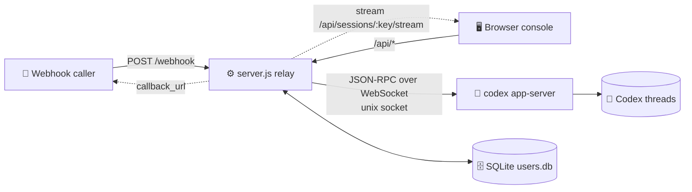

<p align="center"></p>

<h1 align="center">💬 linebot-relay</h1>

<p align="center"><b>Connect webhooks and a web console to your existing Codex threads: read messages, send messages, nothing more.</b></p>

<p align="center">
  <a href="README.md">简体中文</a> · <b>English</b>
</p>

<p align="center">
  
  
  
  
  
  
</p>

---

## ✨ Features

- 🔗 **Existing Codex threads only**: the console and webhook never create Codex threads; unknown IDs get a 404
- ⚡ **Live streaming**: replies, reasoning and command output are pushed as they're generated (streamed HTTP + 15s heartbeat, 3s polling fallback)
- 👥 **Users & permissions**: SQLite-backed; the super admin decides who sees which sessions
- 🖼️ **Images**: AI-generated images shown via signed URLs, click to zoom
- 📎 **Attachments**: up to 5 files, 20 MB each by default
- 📝 **Markdown**: marked + DOMPurify
- 🧵 **Queueing**: per-session serial queue with a global concurrency cap
- 🔔 **Async callbacks**: webhook calls can pass a `callback_url`
- 🌗 **Vue 3 console**: minimal black/white/gray, light & dark, mobile-friendly
- 🪶 **Zero npm deps on the backend**: Node 22 built-ins (`node:sqlite`); `better-sqlite3` is an optional fallback

## 🏗️ Architecture



## 🔐 Roles & permissions

| Capability | 👑 Super admin | 🙋 User |
|---|:---:|:---:|
| Link an **existing** Codex thread | ✅ | ❌ |
| Delete a session (console record only) | ✅ | ❌ |
| Assign sessions to users | ✅ | ❌ |
| Manage users, reset passwords | ✅ | ❌ |
| View webhook token / global stats | ✅ | ❌ |
| View granted sessions & send messages | ✅ | ✅ |
| Change own password | ✅ | ✅ |
| Create a new Codex thread | 🚫 | 🚫 |

> 💡 Sessions not granted to a user return 404, as if they don't exist. `WEBHOOK_TOKEN` carries admin rights and doubles as a console recovery login.

## 🚀 Quick start

```sh
# 1️⃣ Requirements: Node 22+ and a running codex app-server
git clone https://github.com/dylantsai-dev/linebot-relay.git
cd linebot-relay

# 2️⃣ Configure
cp .env.example .env      # set at least WEBHOOK_TOKEN

# 3️⃣ Build the console
cd web && npm ci && npm run build && cd ..

# 4️⃣ Run
set -a; . ./.env; set +a
npm start                 # http://127.0.0.1:8790/console
```

On first visit with no admin yet, log in with `WEBHOOK_TOKEN` and create one (or seed it with `ADMIN_USERNAME` / `ADMIN_PASSWORD`).

## ⚙️ Environment variables

| Variable | Default | Description |
|---|---|---|
| `WEBHOOK_TOKEN` | — **required** | Webhook bearer token; also the super-admin key |
| `PORT` | `8790` | Listen port |
| `HOST` | `127.0.0.1` | Listen address |
| `CODEX_APP_SERVER_SOCK` | — | codex app-server control socket path |
| `CODEX_HOME` | `/root/.codex` | Codex data dir (thread checks, images) |
| `CODEX_BIN` | `/root/.local/bin/codex` | Codex CLI path |
| `CODEX_MODEL` | — | Model override (optional) |
| `CODEX_TIMEOUT_MS` | `600000` | Per-run timeout |
| `MAX_CONCURRENCY` | `2` | Global concurrency cap |
| `MAX_FILES` / `MAX_FILE_BYTES` | `5` / `20971520` | Attachment limits |
| `DATA_DIR` | `/opt/linebot-relay/data` | Sessions, history, user DB |
| `WORK_DIR` / `LOG_DIR` / `UPLOAD_DIR` | `/opt/linebot-relay/{work,logs,uploads}` | Work, log, upload dirs |
| `USERS_DB` | `$DATA_DIR/users.db` | SQLite user DB path |
| `SQLITE_DRIVER` | auto | Force `node:sqlite` or `better-sqlite3` |
| `ADMIN_USERNAME` / `ADMIN_PASSWORD` | — | First-admin seed (ignored once an admin exists) |
| `CONSOLE_DIST` | `web/dist` | Console build dir |
| `CONSOLE_UI` | — | `legacy` serves the old single-file console |

## 🛣️ API

| Method | Path | Access | Purpose |
|---|---|---|---|
| `POST` | `/webhook` | Token | Send to a session (attachments, `callback_url`) |
| `POST` | `/api/send` | Logged in | Send from the console |
| `GET` | `/sessions` | Token | Session list (legacy) |
| `GET` | `/health` | Public | Health check |
| `GET` | `/api/auth/status` | Public | Whether setup is needed |
| `POST` | `/api/auth/login` · `logout` · `password` · `setup` | — / logged in | Login, logout, change password, first admin |
| `GET` | `/api/whoami` | Logged in | Current identity |
| `GET` | `/api/sessions` | Logged in | Visible sessions |
| `PUT` | `/api/sessions/:key` | 👑 | Link an existing Codex thread |
| `DELETE` | `/api/sessions/:key` | 👑 | Delete a session |
| `GET` | `/api/sessions/:key/history` | Granted | History |
| `GET` | `/api/sessions/:key/stream` | Granted | Live stream |
| `GET` | `/api/codex/threads` | 👑 | Existing Codex threads |
| `GET` | `/api/media/...` | Signed URL | Images |
| `GET` | `/api/files` · `/api/requests` · `/api/stats` | Logged in | Files, request log, stats |
| `GET` | `/api/webhook-token` | 👑 | Token for curl snippets |
| `GET/POST` | `/api/users` | 👑 | List / create users |
| `GET/PATCH/DELETE` | `/api/users/:id` | 👑 | Read / update / delete user |
| `PUT` | `/api/users/:id/sessions` | 👑 | Set session grants |
| `POST` | `/api/users/:id/password` | 👑 | Reset password |

```sh
curl -X POST http://127.0.0.1:8790/webhook \
  -H "Authorization: Bearer $WEBHOOK_TOKEN" \
  -H 'Content-Type: application/json' \
  -d '{"session":"my-session","message":"Hello 👋"}'
```

## 🗂️ Project structure

```text
linebot-relay/
├── server.js               # ⚙️ HTTP server, routing, queueing, auth
├── lib/
│   ├── appserver.js        # 🧠 codex app-server JSON-RPC client
│   ├── ws-unix.js          # 🔌 WebSocket over unix socket
│   ├── users.js            # 👥 SQLite users / grants / tokens
│   ├── media.js            # 🖼️ signed image URLs
│   └── attachments.js      # 📎 attachment parsing
├── web/                    # 🌗 Vue 3 + Vite + TS console
│   └── src/ (App.vue, components/, store.ts, brand/mark.svg)
├── console.html            # 🗃️ legacy single-file console
├── test/                   # 🧪 tests (incl. fake app-server)
├── linebot-relay.service   # 🐧 systemd unit
└── .env.example
```

## 🐧 Deployment

1. Put the code in `/opt/linebot-relay` and install **Node 22** (needs `node:sqlite`)
2. Write `/opt/linebot-relay/.env` and `chmod 600` it
3. `cd web && npm ci && npm run build`
4. Install the service:

```sh
cp linebot-relay.service /etc/systemd/system/
systemctl daemon-reload
systemctl enable --now linebot-relay
```

5. Keep it on `127.0.0.1` behind an HTTPS reverse proxy (Nginx, Caddy…)

> ⚠️ The relay only connects to an already-running codex app-server; restarting the relay doesn't affect Codex.

## 🛡️ Security

- 🔑 **scrypt** password hashes; 30-day revocable login tokens
- 🚦 Lockout after 10 failed logins in 15 min (in-memory, cleared on restart)
- 🙈 Unauthorized access gets 404/403 without revealing whether a session exists
- 🖼️ Signed, grant-checked image URLs; path traversal and symlinks blocked
- 🧱 Strict CSP, `nosniff`, `frame-ancestors 'none'` on the console
- 🗄️ `users.db` is mode 600; never commit `.env`

## 🧪 Development & testing

```sh
npm test                  # runs test/run-tests.sh

cd web
npm run dev               # Vite dev server (http://localhost:5173)
npm run typecheck         # vue-tsc
```

---

<p align="center">Made with ☕ & 🤖</p>
