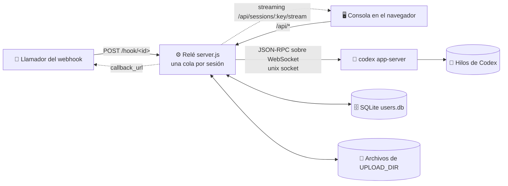
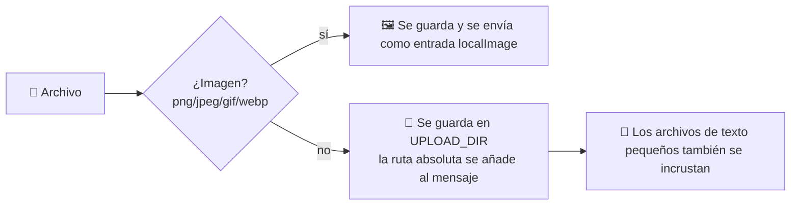

<p align="center"></p>

<h1 align="center">💬 linebot-relay</h1>

<p align="center"><b>Conecta webhooks y una consola web a tus hilos de Codex ya existentes: leer mensajes, enviar mensajes, nada más.</b></p>

<p align="center">
  <a href="README.md">简体中文</a> · <a href="README.en.md">English</a> · <a href="README.ja.md">日本語</a> · <b>Español</b> · <a href="README.fr.md">Français</a> · <a href="README.ru.md">Русский</a>
</p>

<p align="center">
  
  
  
  
  
  
</p>

---

## 🎯 Por qué existe este proyecto

Codex es un agente muy capaz: lee reglas, llama a herramientas MCP, carga skills y mantiene un contexto duradero dentro de un hilo. Pero, tal como viene, vive en **la máquina de una sola persona, dentro de la app de Codex de una sola persona**. Para atender al cliente de un comercio electrónico japonés necesitábamos algo más:

1. **Que los sistemas externos puedan entregarle mensajes.** Los mensajes de LINE, del panel de la tienda o del sistema de pedidos deben llegar al hilo de Codex correcto con una sola petición HTTP, y la respuesta debe volver.
2. **Que varias personas lo vean y lo usen sin que cada una instale Codex.** Soporte, operaciones y responsables abren una consola en el navegador, ven qué ha pasado en un hilo y continúan la conversación.
3. **Que el acceso esté bien controlado.** Cada persona solo ve los hilos que tiene asignados; solo el superadministrador añade, elimina o asigna hilos, y nadie puede usar la consola para crear hilos nuevos de Codex.

linebot-relay es esa capa intermedia, un **relé con consola**:

- 🧵 **Mismo hilo, mismo contexto**: solo se conecta a hilos que ya existen en Codex. La app de Codex, los webhooks y la consola web comparten un único contexto, y cada mensaje entra en la misma cola por hilo, así que nunca chocan.
- 🪝 **Una entrada por hilo**: cada hilo tiene su propia URL de webhook y su propia clave. Una clave filtrada afecta a un solo hilo y se puede restablecer en cualquier momento; además, un hilo se puede pausar con un clic.
- 🖥️ **Una interfaz limpia y pensada para el exterior**: la consola lleva la marca 「ディランボット 三代目」. Los usuarios finales ven mensajes, archivos y progreso, no el motor que hay detrás.
- 🧩 **No es un Codex web**: nunca crea hilos, no cambia la configuración de Codex ni toca su proceso. Solo introduce mensajes, extrae el progreso y los resultados, y los muestra a las personas adecuadas.

En una frase: **que un agente de Codex ya afinado pueda ser invocado por los sistemas de negocio y compartido de forma segura por un equipo.**

---

## ✨ Funciones

- 🔗 **Solo hilos de Codex existentes**: la consola y los webhooks nunca crean hilos de Codex; los ID desconocidos reciben un 404
- ⚡ **Streaming en vivo**: respuestas, razonamiento y salida de comandos se envían a medida que se generan (HTTP en streaming + latido cada 15 s, con sondeo cada 3 s como respaldo)
- 🔄 **Resistente a recargas**: la URL lleva `#s=<session>`, así que al recargar vuelves a la misma sesión y un turno en curso sigue transmitiéndose, marcado como "运行中" (en ejecución)
- ⏹️ **Botón de parada**: interrumpe el turno en curso con `turn/interrupt` del app-server
- 🚦 **Cola / guiar**: mientras la IA está ocupada, elige 排队 (cola: enviar tras el turno actual) o 引导 (guiar: inyectar en el turno en curso con `turn/steer`)
- 📎 **Cualquier tipo de archivo**: las imágenes llegan a Codex como entrada de imagen; los demás archivos se guardan en el servidor y sus rutas absolutas se pasan a Codex. Admite arrastrar y soltar, pegar y selección múltiple
- ⬇️ **Chips de descarga**: los adjuntos del historial se muestran como chips de archivo con enlaces de descarga firmados
- 🪝 **Un webhook por hilo**: `POST /hook/<id>` con la clave `dbk_` propia del hilo; la URL decide el hilo. Los administradores la consultan, copian el curl y restablecen la clave en la consola; `mode` elige cola / guiar; admite subidas multipart
- ⏸️ **Pausar la recepción**: los administradores pausan un hilo con un clic; mientras está en pausa su webhook devuelve `423`, y la consola sigue pudiendo enviar
- 👥 **Usuarios y permisos**: basado en SQLite; el superadministrador decide quién ve qué sesiones
- 🖼️ **Imágenes**: las imágenes generadas por la IA se muestran mediante URL firmadas; clic para ampliar
- 📝 **Markdown**: marked + DOMPurify
- 🔔 **Callbacks asíncronos**: los webhooks pueden pasar un `callback_url` para recibir el resultado
- 🌗 **Consola en Vue 3**: temas claro y oscuro, adaptada a móviles
- 🪶 **Cero dependencias npm en el backend**: módulos integrados de Node 22 (`node:sqlite`), con `better-sqlite3` como respaldo opcional

## 🏗️ Arquitectura



## 🚦 Cola frente a guiar

| Modo | 🧵 IA inactiva | 🏃 IA ejecutando un turno |
|---|---|---|
| 📥 **Cola** `queue` (por defecto) | Se envía de inmediato como un turno nuevo | Espera en la cola de la sesión y se envía en orden tras el turno actual |
| 🧭 **Guiar** `steer` | Salta al principio de la cola y se envía de inmediato | Se inyecta en el turno en curso con `turn/steer` (con `expectedTurnId`) |

- 🛟 **Respaldos**: si no hay un turno en curso, o Codex rechaza la guía, el mensaje se envía a continuación desde el principio de la cola y la respuesta incluye `steer_fallback` (`no_active_turn` / `steer_rejected`)
- 🗂️ Los mensajes en cola aparecen en la consola y se pueden retirar antes de enviarse (los usuarios normales, solo los suyos)
- 🔁 Sea quien sea quien inició el turno en curso (la consola, un webhook o la propia app de Codex), los mensajes en cola esperan hasta que el hilo quede inactivo

## 📎 Subida de archivos



- 🖱️ Consola: botón del clip, arrastrar y soltar sobre la ventana, o pegar con `Ctrl/⌘+V`
- 🪝 Webhook: `multipart/form-data` (campo `file` o `files`), o JSON `files: [{name, content_base64, mime}]` / `file_urls: [...]`
- 📏 Límites por defecto: **50 MB** por archivo, **10** archivos, **100 MB** en total (ver variables de entorno)
- 🔏 Los adjuntos del historial se muestran como chips de archivo y se descargan mediante enlaces firmados de corta duración

## 🔐 Roles y permisos

| Capacidad | 👑 Superadministrador | 🙋 Usuario |
|---|:---:|:---:|
| Vincular un hilo de Codex **existente** | ✅ | ❌ |
| Eliminar una sesión (solo el registro de la consola, Codex no se toca) | ✅ | ❌ |
| Asignar sesiones a usuarios | ✅ | ❌ |
| Gestionar usuarios, restablecer contraseñas | ✅ | ❌ |
| Ver / restablecer webhooks de hilos, pausar la recepción, estadísticas globales | ✅ | ❌ |
| Leer las sesiones asignadas, enviar mensajes, subir archivos | ✅ | ✅ |
| Cola / guiar / detener turnos (sesiones asignadas) | ✅ | ✅ |
| Retirar mensajes en cola | ✅ todos | ✅ solo los propios |
| Cambiar la propia contraseña | ✅ | ✅ |
| Crear hilos en Codex | 🚫 | 🚫 |

> 💡 Las sesiones no asignadas devuelven 404 a los usuarios normales, como si no existieran. `WEBHOOK_TOKEN` tiene derechos de administrador y sirve también como inicio de sesión de emergencia en la consola.

## 🚀 Inicio rápido

```sh
# 1️⃣ Requisitos: Node 22+ y un codex app-server en ejecución
git clone https://github.com/dylantsai-dev/linebot-relay.git
cd linebot-relay

# 2️⃣ Configurar
cp .env.example .env      # define al menos WEBHOOK_TOKEN

# 3️⃣ Compilar la consola
cd web && npm ci && npm run build && cd ..

# 4️⃣ Ejecutar
set -a; . ./.env; set +a
npm start                 # http://127.0.0.1:8790/console
```

En la primera visita, si aún no hay administrador, inicia sesión con `WEBHOOK_TOKEN` y crea uno (o créalo de antemano con `ADMIN_USERNAME` / `ADMIN_PASSWORD`).

## ⚙️ Variables de entorno

| Variable | Por defecto | Descripción |
|---|---|---|
| `WEBHOOK_TOKEN` | — **obligatoria** | Clave de superadministrador (configuración inicial e inicio de sesión de emergencia); ya no se usa para enviar webhooks |
| `PORT` | `8790` | Puerto de escucha |
| `HOST` | `127.0.0.1` | Dirección de escucha |
| `CODEX_APP_SERVER_SOCK` | — | Socket de control del codex app-server |
| `CODEX_HOME` | `/root/.codex` | Directorio de datos de Codex (comprobación de hilos, imágenes) |
| `CODEX_BIN` | `/root/.local/bin/codex` | Ruta de la CLI de Codex |
| `CODEX_MODEL` | — | Modelo alternativo (opcional) |
| `CODEX_TIMEOUT_MS` | `600000` | Tiempo límite por ejecución |
| `MAX_CONCURRENCY` | `2` | Límite global de concurrencia |
| `MAX_FILE_BYTES` | `52428800` (50 MB) | Tamaño máximo por archivo |
| `MAX_FILES` | `10` | Máximo de archivos por mensaje |
| `MAX_TOTAL_BYTES` | `104857600` (100 MB) | Tamaño total máximo de archivos por mensaje |
| `DATA_DIR` | `/opt/linebot-relay/data` | Sesiones, historial, base de datos de usuarios |
| `WORK_DIR` / `LOG_DIR` / `UPLOAD_DIR` | `/opt/linebot-relay/{work,logs,uploads}` | Directorios de trabajo, registros y subidas |
| `USERS_DB` | `$DATA_DIR/users.db` | Ruta de la base de datos SQLite de usuarios |
| `SQLITE_DRIVER` | auto | Fuerza `node:sqlite` o `better-sqlite3` |
| `ADMIN_USERNAME` / `ADMIN_PASSWORD` | — | Crea el primer administrador (se ignora si ya existe uno) |
| `CONSOLE_DIST` | `web/dist` | Directorio de la consola compilada |
| `CONSOLE_UI` | — | Ponlo en `legacy` para usar la antigua consola de un solo archivo |

## 🛣️ API

| Método | Ruta | Autenticación | Descripción |
|---|---|---|---|
| `POST` | `/hook/:id` | Clave del hilo | Envía a este hilo, `mode` = `queue` (por defecto) / `steer`; `423` mientras está en pausa |
| `POST` | `/webhook` · `/webhook/queue` · `/webhook/steer` | — | 🚫 Retirado, devuelve `410` |
| `POST` | `/api/send` | Sesión iniciada | Envío desde la consola; `async=1` devuelve 202 al instante (`id`, `status`, `position`), y luego se sigue el stream |
| `GET` | `/sessions` | Token | Lista de sesiones (heredado) |
| `GET` | `/health` | Pública | Comprobación de estado |
| `GET` | `/api/auth/status` | Pública | Si hace falta la configuración inicial |
| `POST` | `/api/auth/login` · `logout` · `password` · `setup` | — / Sesión iniciada | Iniciar sesión, cerrar sesión, cambiar contraseña, crear el primer administrador |
| `GET` | `/api/whoami` | Sesión iniciada | Identidad actual |
| `GET` | `/api/sessions` | Sesión iniciada | Sesiones visibles (con estado `running` / `queued`) |
| `PUT` | `/api/sessions/:key` | 👑 | Vincular un hilo de Codex existente |
| `PATCH` | `/api/sessions/:key` | 👑 | Renombrar; `paused: true/false` pausa o reanuda la recepción |
| `DELETE` | `/api/sessions/:key` | 👑 | Eliminar una sesión |
| `GET` | `/api/sessions/:key/webhook` | 👑 | Ver la URL de webhook y la clave del hilo |
| `POST` | `/api/sessions/:key/webhook/rotate` | 👑 | Restablecer la clave (misma URL, la clave antigua deja de funcionar) |
| `GET` | `/api/sessions/:key/history` | Con permiso | Historial de mensajes (con adjuntos) |
| `GET` | `/api/sessions/:key/stream` | Con permiso | Stream en vivo (instantánea + deltas, retoma turnos en curso) |
| `GET` | `/api/sessions/:key/queue` | Con permiso | Cola actual (running / steered / queued) |
| `DELETE` | `/api/sessions/:key/queue/:id` | Con permiso | Retirar un mensaje en cola aún no enviado |
| `POST` | `/api/sessions/:key/interrupt` | Con permiso | ⏹️ Detener el turno en curso |
| `GET` | `/api/codex/threads` | 👑 | Hilos de Codex existentes |
| `GET` | `/api/media/...` | URL firmada | Vista previa de imagen / descarga de archivo |
| `GET` | `/api/files` · `/api/requests` · `/api/stats` | Sesión iniciada | Archivos, registro de peticiones, estadísticas |
| `GET` | `/api/webhook-token` | 👑 | Obtener el token (para fragmentos curl) |
| `GET/POST` | `/api/users` | 👑 | Listar / crear usuarios |
| `GET/PATCH/DELETE` | `/api/users/:id` | 👑 | Leer / actualizar / eliminar un usuario |
| `PUT` | `/api/users/:id/sessions` | 👑 | Definir los permisos de sesiones |
| `POST` | `/api/users/:id/password` | 👑 | Restablecer la contraseña |

### 🧪 Ejemplos de webhook

```sh
# 💬 Cola (por defecto), esperar la respuesta
# Copia la URL y la clave desde la consola: sesión → Webhook
curl -X POST "$HOOK_URL" \
  -H "Authorization: Bearer $HOOK_KEY" \
  -H 'Content-Type: application/json' \
  -d '{"message":"Hola 👋"}'

# 🧭 Guiar el turno en curso
curl -X POST "$HOOK_URL" \
  -H "Authorization: Bearer $HOOK_KEY" \
  -H 'Content-Type: application/json' \
  -d '{"message":"Ejecuta también las pruebas","mode":"steer"}'

# 📎 Con archivos (multipart) y un callback
curl -X POST "$HOOK_URL" \
  -H "Authorization: Bearer $HOOK_KEY" \
  -F message='Revisa estos dos archivos, por favor' \
  -F callback_url=https://example.com/callback \
  -F file=@report.pdf \
  -F file=@screenshot.png
```

> 🔔 Con `callback_url` la llamada devuelve `202 {accepted, id, mode}` de inmediato y hace POST del resultado al callback al terminar; sin él, la llamada espera la respuesta.

## 🗂️ Estructura del proyecto

```text
linebot-relay/
├── server.js               # ⚙️ servidor HTTP, enrutado, cola / guiar, autenticación
├── lib/
│   ├── appserver.js        # 🧠 cliente JSON-RPC del codex app-server
│   ├── ws-unix.js          # 🔌 WebSocket sobre unix socket
│   ├── users.js            # 👥 usuarios / permisos / tokens en SQLite
│   ├── media.js            # 🖼️ URL de imagen firmadas
│   └── attachments.js      # 📎 análisis de adjuntos (multipart / base64 / URL)
├── web/                    # 🌗 consola Vue 3 + Vite + TS
│   └── src/ (App.vue, components/, store.ts, brand/mark.svg)
├── console.html            # 🗃️ antigua consola de un solo archivo
├── test/                   # 🧪 pruebas (incl. un app-server falso)
├── linebot-relay.service   # 🐧 unidad de systemd
└── .env.example
```

## 🐧 Despliegue

1. Coloca el código en `/opt/linebot-relay` e instala **Node 22** (necesita `node:sqlite`)
2. Escribe `/opt/linebot-relay/.env` y aplícale `chmod 600`
3. `cd web && npm ci && npm run build`
4. Instala el servicio:

```sh
cp linebot-relay.service /etc/systemd/system/
systemctl daemon-reload
systemctl enable --now linebot-relay
```

5. Mantenlo en `127.0.0.1` detrás de un proxy inverso HTTPS (Nginx, Caddy…)

> ⚠️ El relé solo se conecta a un codex app-server que ya esté en ejecución; reiniciar el relé no afecta a Codex.

## 🛡️ Seguridad

- 🔑 Contraseñas con hash **scrypt**; tokens de sesión de 30 días revocables
- 🚦 Bloqueo tras 10 inicios de sesión fallidos en 15 min (en memoria, se borra al reiniciar)
- 🙈 Los accesos no autorizados reciben 404/403 sin revelar si la sesión existe
- 🖼️ URL de imagen firmadas y con comprobación de permisos; se bloquean el path traversal y los enlaces simbólicos
- 🧱 CSP estricta, `nosniff` y `frame-ancestors 'none'` en la consola
- 🗄️ `users.db` tiene modo 600; nunca hagas commit de `.env`

## 🧪 Desarrollo y pruebas

```sh
npm test                  # ejecuta test/run-tests.sh

cd web
npm run dev               # servidor de desarrollo de Vite (http://localhost:5173)
npm run typecheck         # vue-tsc
```

---

<p align="center">Made with ☕ & 🤖</p>
