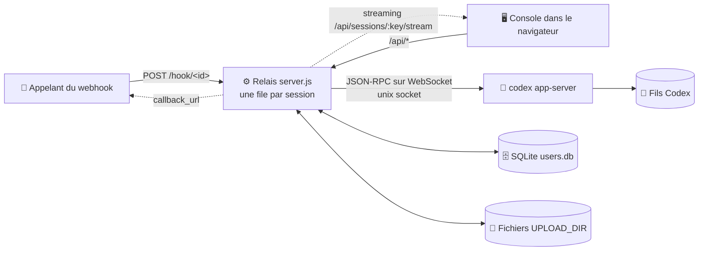
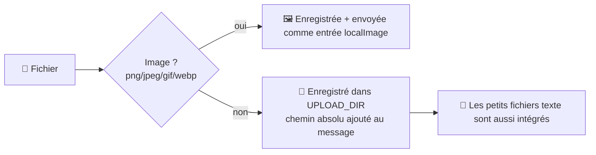

<p align="center"></p>

<h1 align="center">💬 linebot-relay</h1>

<p align="center"><b>Branchez des webhooks et une console web sur vos fils Codex existants : lire des messages, envoyer des messages, rien de plus.</b></p>

<p align="center">
  <a href="README.md">简体中文</a> · <a href="README.en.md">English</a> · <a href="README.ja.md">日本語</a> · <a href="README.es.md">Español</a> · <b>Français</b> · <a href="README.ru.md">Русский</a>
</p>

<p align="center">
  
  
  
  
  
  
</p>

---

## 🎯 Pourquoi ce projet existe

Codex est un agent compétent : il lit des règles, appelle des outils MCP, charge des skills et conserve un contexte durable dans un fil. Mais tel quel, il vit sur **la machine d'une seule personne, dans l'app Codex d'une seule personne**. Pour assurer le service client d'une boutique en ligne japonaise, il nous fallait autre chose :

1. **Les systèmes externes doivent pouvoir lui transmettre des messages.** Les messages venant de LINE, du back-office de la boutique ou du système de commandes doivent arriver dans le bon fil Codex en une seule requête HTTP, et la réponse doit revenir.
2. **Plusieurs personnes doivent pouvoir le suivre et l'utiliser sans installer Codex chacune.** Le support, les opérations et les responsables ouvrent une console dans le navigateur, voient ce qui s'est passé dans un fil et poursuivent la conversation.
3. **Les accès doivent rester stricts.** Chacun ne voit que les fils qui lui sont attribués ; seul le super-administrateur ajoute, supprime ou attribue des fils, et personne ne peut se servir de la console pour créer de nouveaux fils Codex.

linebot-relay est cette couche intermédiaire, un **relais doublé d'une console** :

- 🧵 **Même fil, même contexte** : il se connecte uniquement à des fils qui existent déjà dans Codex. L'app Codex, les webhooks et la console web partagent un seul contexte, et chaque message entre dans la même file d'attente par fil, si bien qu'ils ne se télescopent jamais.
- 🪝 **Un point d'entrée par fil** : chaque fil a sa propre URL de webhook et sa propre clé. Une clé divulguée ne touche qu'un seul fil et peut être réinitialisée à tout moment, et un fil peut être mis en pause en un clic.
- 🖥️ **Une interface sobre, tournée vers l'extérieur** : la console porte la marque 「ディランボット 三代目」. Les utilisateurs finaux voient des messages, des fichiers et l'avancement, pas le moteur qui tourne derrière.
- 🧩 **Pas un Codex web** : il ne crée jamais de fil, ne modifie pas la configuration de Codex et ne touche pas à son processus. Il se contente de faire entrer les messages, de faire sortir l'avancement et les résultats, et de les montrer aux bonnes personnes.

En une phrase : **permettre à un agent Codex déjà bien réglé d'être appelé par les systèmes métier et partagé en toute sécurité par une équipe.**

---

## ✨ Fonctionnalités

- 🔗 **Uniquement des fils Codex existants** : la console et les webhooks ne créent jamais de fil Codex ; un ID inconnu renvoie 404
- ⚡ **Streaming en direct** : réponses, raisonnement et sortie des commandes sont poussés au fil de leur génération (HTTP en streaming + battement toutes les 15 s, repli sur un sondage toutes les 3 s)
- 🔄 **Résiste au rechargement** : l'URL contient `#s=<session>`, donc un rechargement ramène à la session et un tour en cours continue de s'afficher, marqué « 运行中 » (en cours)
- ⏹️ **Bouton d'arrêt** : interrompt le tour en cours via `turn/interrupt` de l'app-server
- 🚦 **File / guidage** : pendant que l'IA travaille, choisissez 排队 (file : envoyer après le tour en cours) ou 引导 (guidage : injecter dans le tour en cours avec `turn/steer`)
- 📎 **Tous types de fichiers** : les images sont transmises à Codex comme entrée image ; les autres fichiers sont enregistrés sur le serveur et leurs chemins absolus sont transmis à Codex. Glisser-déposer, collage et sélection multiple pris en charge
- ⬇️ **Pastilles de téléchargement** : les pièces jointes de l'historique s'affichent sous forme de pastilles avec des liens de téléchargement signés
- 🪝 **Un webhook par fil** : `POST /hook/<id>` avec la clé `dbk_` propre au fil ; l'URL détermine le fil. Les administrateurs la consultent, copient le curl et réinitialisent la clé dans la console ; `mode` choisit file / guidage ; envois multipart pris en charge
- ⏸️ **Suspendre la réception** : les administrateurs mettent un fil en pause en un clic ; pendant la pause, son webhook renvoie `423`, et la console peut toujours envoyer
- 👥 **Utilisateurs et permissions** : basé sur SQLite ; le super-administrateur décide qui voit quelles sessions
- 🖼️ **Images** : les images générées par l'IA s'affichent via des URL signées, clic pour agrandir
- 📝 **Markdown** : marked + DOMPurify
- 🔔 **Callbacks asynchrones** : les webhooks peuvent fournir un `callback_url` pour recevoir le résultat
- 🌗 **Console Vue 3** : thèmes clair et sombre, adaptée au mobile
- 🪶 **Zéro dépendance npm côté backend** : modules intégrés de Node 22 (`node:sqlite`), avec `better-sqlite3` en repli facultatif

## 🏗️ Architecture



## 🚦 File ou guidage

| Mode | 🧵 IA inactive | 🏃 IA en train d'exécuter un tour |
|---|---|---|
| 📥 **File** `queue` (par défaut) | Envoyé immédiatement comme nouveau tour | Attend dans la file de la session, envoyé dans l'ordre après le tour en cours |
| 🧭 **Guidage** `steer` | Passe en tête de file, envoyé immédiatement | Injecté dans le tour en cours via `turn/steer` (avec `expectedTurnId`) |

- 🛟 **Replis** : s'il n'y a pas de tour en cours, ou si Codex refuse le guidage, le message est envoyé ensuite depuis la tête de la file et la réponse contient `steer_fallback` (`no_active_turn` / `steer_rejected`)
- 🗂️ Les messages en file sont listés dans la console et peuvent être retirés avant leur envoi (les utilisateurs normaux, seulement les leurs)
- 🔁 Quel que soit l'auteur du tour en cours (console, webhook ou l'app Codex elle-même), les messages en file attendent que le fil soit inactif

## 📎 Envoi de fichiers



- 🖱️ Console : bouton trombone, glisser-déposer sur la fenêtre, ou collage avec `Ctrl/⌘+V`
- 🪝 Webhook : `multipart/form-data` (champ `file` ou `files`), ou JSON `files: [{name, content_base64, mime}]` / `file_urls: [...]`
- 📏 Limites par défaut : **50 Mo** par fichier, **10** fichiers, **100 Mo** au total (voir les variables d'environnement)
- 🔏 Les pièces jointes de l'historique s'affichent sous forme de pastilles et se téléchargent via des liens signés à durée de vie courte

## 🔐 Rôles et permissions

| Capacité | 👑 Super-administrateur | 🙋 Utilisateur |
|---|:---:|:---:|
| Associer un fil Codex **existant** | ✅ | ❌ |
| Supprimer une session (enregistrement de la console uniquement, Codex intact) | ✅ | ❌ |
| Attribuer des sessions aux utilisateurs | ✅ | ❌ |
| Gérer les utilisateurs, réinitialiser les mots de passe | ✅ | ❌ |
| Consulter / réinitialiser les webhooks des fils, suspendre la réception, statistiques globales | ✅ | ❌ |
| Lire les sessions attribuées, envoyer des messages, envoyer des fichiers | ✅ | ✅ |
| File / guidage / arrêt des tours (sessions attribuées) | ✅ | ✅ |
| Retirer des messages en file | ✅ tous | ✅ les siens seulement |
| Changer son propre mot de passe | ✅ | ✅ |
| Créer des fils dans Codex | 🚫 | 🚫 |

> 💡 Les sessions non attribuées renvoient 404 aux utilisateurs normaux, comme si elles n'existaient pas. `WEBHOOK_TOKEN` a les droits d'administrateur et sert aussi de connexion de secours à la console.

## 🚀 Démarrage rapide

```sh
# 1️⃣ Prérequis : Node 22+ et un codex app-server en cours d'exécution
git clone https://github.com/dylantsai-dev/linebot-relay.git
cd linebot-relay

# 2️⃣ Configurer
cp .env.example .env      # définir au moins WEBHOOK_TOKEN

# 3️⃣ Compiler la console
cd web && npm ci && npm run build && cd ..

# 4️⃣ Lancer
set -a; . ./.env; set +a
npm start                 # http://127.0.0.1:8790/console
```

Lors de la première visite, s'il n'y a pas encore d'administrateur, connectez-vous avec `WEBHOOK_TOKEN` et créez-en un (ou pré-créez-le avec `ADMIN_USERNAME` / `ADMIN_PASSWORD`).

## ⚙️ Variables d'environnement

| Variable | Défaut | Description |
|---|---|---|
| `WEBHOOK_TOKEN` | — **obligatoire** | Clé de super-administrateur (configuration initiale et connexion de secours) ; ne sert plus à envoyer des webhooks |
| `PORT` | `8790` | Port d'écoute |
| `HOST` | `127.0.0.1` | Adresse d'écoute |
| `CODEX_APP_SERVER_SOCK` | — | Socket de contrôle du codex app-server |
| `CODEX_HOME` | `/root/.codex` | Répertoire de données de Codex (vérification des fils, images) |
| `CODEX_BIN` | `/root/.local/bin/codex` | Chemin de la CLI Codex |
| `CODEX_MODEL` | — | Modèle imposé (facultatif) |
| `CODEX_TIMEOUT_MS` | `600000` | Délai maximal par exécution |
| `MAX_CONCURRENCY` | `2` | Plafond global de concurrence |
| `MAX_FILE_BYTES` | `52428800` (50 Mo) | Taille maximale par fichier |
| `MAX_FILES` | `10` | Nombre maximal de fichiers par message |
| `MAX_TOTAL_BYTES` | `104857600` (100 Mo) | Taille totale maximale des fichiers par message |
| `DATA_DIR` | `/opt/linebot-relay/data` | Sessions, historique, base des utilisateurs |
| `WORK_DIR` / `LOG_DIR` / `UPLOAD_DIR` | `/opt/linebot-relay/{work,logs,uploads}` | Répertoires de travail, de journaux et d'envois |
| `USERS_DB` | `$DATA_DIR/users.db` | Chemin de la base SQLite des utilisateurs |
| `SQLITE_DRIVER` | auto | Forcer `node:sqlite` ou `better-sqlite3` |
| `ADMIN_USERNAME` / `ADMIN_PASSWORD` | — | Pré-créer le premier administrateur (ignoré dès qu'il en existe un) |
| `CONSOLE_DIST` | `web/dist` | Répertoire de la console compilée |
| `CONSOLE_UI` | — | Mettre `legacy` pour l'ancienne console en un seul fichier |

## 🛣️ API

| Méthode | Chemin | Authentification | Description |
|---|---|---|---|
| `POST` | `/hook/:id` | Clé du fil | Envoyer à ce fil, `mode` = `queue` (par défaut) / `steer` ; `423` pendant la pause |
| `POST` | `/webhook` · `/webhook/queue` · `/webhook/steer` | — | 🚫 Retiré, renvoie `410` |
| `POST` | `/api/send` | Connexion | Envoi depuis la console ; `async=1` renvoie 202 immédiatement (`id`, `status`, `position`), puis suivez le flux |
| `GET` | `/sessions` | Jeton | Liste des sessions (ancien) |
| `GET` | `/health` | Public | Vérification de santé |
| `GET` | `/api/auth/status` | Public | Indique si la configuration initiale est nécessaire |
| `POST` | `/api/auth/login` · `logout` · `password` · `setup` | — / Connexion | Connexion, déconnexion, changement de mot de passe, création du premier administrateur |
| `GET` | `/api/whoami` | Connexion | Identité actuelle |
| `GET` | `/api/sessions` | Connexion | Sessions visibles (avec l'état `running` / `queued`) |
| `PUT` | `/api/sessions/:key` | 👑 | Associer un fil Codex existant |
| `PATCH` | `/api/sessions/:key` | 👑 | Renommer ; `paused: true/false` suspend ou reprend la réception |
| `DELETE` | `/api/sessions/:key` | 👑 | Supprimer une session |
| `GET` | `/api/sessions/:key/webhook` | 👑 | Voir l'URL de webhook et la clé du fil |
| `POST` | `/api/sessions/:key/webhook/rotate` | 👑 | Réinitialiser la clé (même URL, l'ancienne clé cesse de fonctionner) |
| `GET` | `/api/sessions/:key/history` | Autorisé | Historique des messages (avec pièces jointes) |
| `GET` | `/api/sessions/:key/stream` | Autorisé | Flux en direct (instantané + deltas, reprend les tours en cours) |
| `GET` | `/api/sessions/:key/queue` | Autorisé | File actuelle (running / steered / queued) |
| `DELETE` | `/api/sessions/:key/queue/:id` | Autorisé | Retirer un message en file pas encore envoyé |
| `POST` | `/api/sessions/:key/interrupt` | Autorisé | ⏹️ Arrêter le tour en cours |
| `GET` | `/api/codex/threads` | 👑 | Fils Codex existants |
| `GET` | `/api/media/...` | URL signée | Aperçu d'image / téléchargement de fichier |
| `GET` | `/api/files` · `/api/requests` · `/api/stats` | Connexion | Fichiers, journal des requêtes, statistiques |
| `GET` | `/api/webhook-token` | 👑 | Obtenir le jeton (pour les extraits curl) |
| `GET/POST` | `/api/users` | 👑 | Lister / créer des utilisateurs |
| `GET/PATCH/DELETE` | `/api/users/:id` | 👑 | Lire / modifier / supprimer un utilisateur |
| `PUT` | `/api/users/:id/sessions` | 👑 | Définir les sessions autorisées |
| `POST` | `/api/users/:id/password` | 👑 | Réinitialiser le mot de passe |

### 🧪 Exemples de webhook

```sh
# 💬 File (par défaut), attendre la réponse
# Copiez l'URL et la clé depuis la console : session → Webhook
curl -X POST "$HOOK_URL" \
  -H "Authorization: Bearer $HOOK_KEY" \
  -H 'Content-Type: application/json' \
  -d '{"message":"Bonjour 👋"}'

# 🧭 Guider le tour en cours
curl -X POST "$HOOK_URL" \
  -H "Authorization: Bearer $HOOK_KEY" \
  -H 'Content-Type: application/json' \
  -d '{"message":"Lance aussi les tests","mode":"steer"}'

# 📎 Avec des fichiers (multipart) et un callback
curl -X POST "$HOOK_URL" \
  -H "Authorization: Bearer $HOOK_KEY" \
  -F message='Merci de relire ces deux fichiers' \
  -F callback_url=https://example.com/callback \
  -F file=@report.pdf \
  -F file=@screenshot.png
```

> 🔔 Avec `callback_url`, l'appel renvoie immédiatement `202 {accepted, id, mode}` et envoie le résultat en POST au callback une fois terminé ; sans lui, l'appel attend la réponse.

## 🗂️ Structure du projet

```text
linebot-relay/
├── server.js               # ⚙️ serveur HTTP, routage, file / guidage, authentification
├── lib/
│   ├── appserver.js        # 🧠 client JSON-RPC du codex app-server
│   ├── ws-unix.js          # 🔌 WebSocket sur unix socket
│   ├── users.js            # 👥 utilisateurs / autorisations / jetons SQLite
│   ├── media.js            # 🖼️ URL d'images signées
│   └── attachments.js      # 📎 analyse des pièces jointes (multipart / base64 / URL)
├── web/                    # 🌗 console Vue 3 + Vite + TS
│   └── src/ (App.vue, components/, store.ts, brand/mark.svg)
├── console.html            # 🗃️ ancienne console en un seul fichier
├── test/                   # 🧪 tests (dont un faux app-server)
├── linebot-relay.service   # 🐧 unité systemd
└── .env.example
```

## 🐧 Déploiement

1. Placez le code dans `/opt/linebot-relay` et installez **Node 22** (`node:sqlite` est requis)
2. Écrivez `/opt/linebot-relay/.env` et appliquez-lui `chmod 600`
3. `cd web && npm ci && npm run build`
4. Installez le service :

```sh
cp linebot-relay.service /etc/systemd/system/
systemctl daemon-reload
systemctl enable --now linebot-relay
```

5. Gardez-le sur `127.0.0.1`, derrière un proxy inverse HTTPS (Nginx, Caddy…)

> ⚠️ Le relais se connecte seulement à un codex app-server déjà lancé ; redémarrer le relais n'affecte pas Codex.

## 🛡️ Sécurité

- 🔑 Mots de passe hachés avec **scrypt** ; jetons de connexion de 30 jours révocables
- 🚦 Verrouillage après 10 échecs de connexion en 15 min (en mémoire, effacé au redémarrage)
- 🙈 Les accès non autorisés reçoivent 404/403 sans révéler si une session existe
- 🖼️ URL d'images signées et soumises au contrôle des autorisations ; traversée de chemin et liens symboliques bloqués
- 🧱 CSP stricte, `nosniff` et `frame-ancestors 'none'` sur la console
- 🗄️ `users.db` est en mode 600 ; ne commitez jamais `.env`

## 🧪 Développement et tests

```sh
npm test                  # lance test/run-tests.sh

cd web
npm run dev               # serveur de développement Vite (http://localhost:5173)
npm run typecheck         # vue-tsc
```

---

<p align="center">Made with ☕ & 🤖</p>
