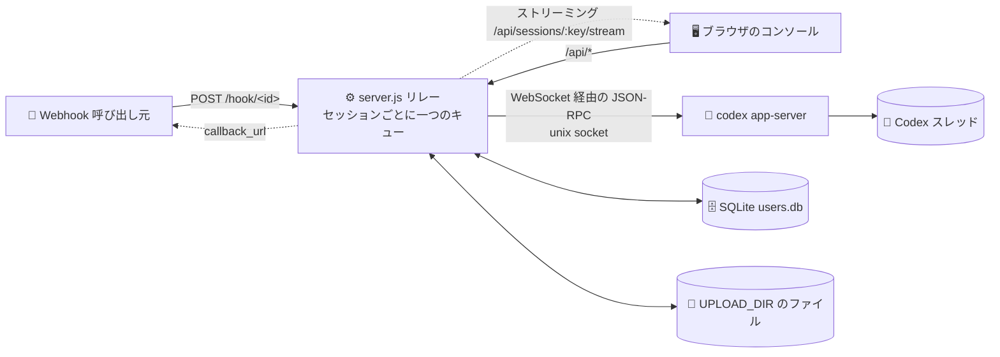
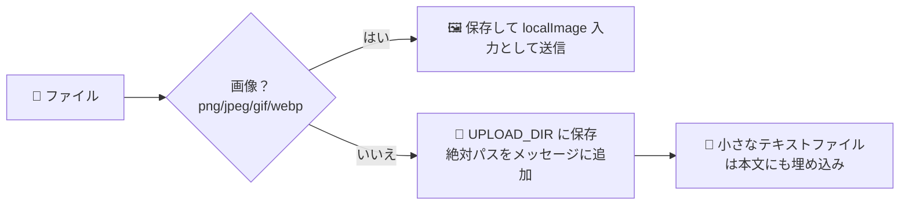

<p align="center"></p>

<h1 align="center">💬 linebot-relay</h1>

<p align="center"><b>Webhook と Web コンソールを既存の Codex スレッドにつなぎます。メッセージを読む、送る。それだけです。</b></p>

<p align="center">
  <a href="README.md">简体中文</a> · <a href="README.en.md">English</a> · <b>日本語</b> · <a href="README.es.md">Español</a> · <a href="README.fr.md">Français</a> · <a href="README.ru.md">Русский</a>
</p>

<p align="center">
  
  
  
  
  
  
</p>

---

## 🎯 このプロジェクトが存在する理由

Codex は優秀なエージェントです。ルールを読み、MCP ツールを呼び出し、スキルを読み込み、スレッドの中で長期的なコンテキストを保ちます。しかし標準のままでは、**一人のマシンの、一人の Codex アプリの中**でしか動きません。日本の EC ビジネスでカスタマーサポートを運営するにあたり、私たちには別のものが必要でした。

1. **外部システムからメッセージを渡せること。** LINE、ショップの管理画面、受注システムからのメッセージを、1 回の HTTP リクエストで正しい Codex スレッドに届け、返信を受け取れる必要があります。
2. **各自が Codex をインストールしなくても、複数人で見て使えること。** サポート、運用、リーダーがブラウザでコンソールを開き、スレッドで何が起きたかを確認し、会話を続けられる必要があります。
3. **権限を厳密に保つこと。** 各自が見られるのは割り当てられたスレッドだけです。スレッドの追加・削除・割り当てはスーパー管理者のみが行い、コンソールから新しい Codex スレッドを作ることは誰にもできません。

linebot-relay はその中間層、つまり**リレー＋コンソール**です。

- 🧵 **同じスレッド、同じコンテキスト**：Codex にすでに存在するスレッドにのみ接続します。Codex アプリ、Webhook、Web コンソールは一つのコンテキストを共有し、すべてのメッセージはスレッドごとの同じキューに入るため、衝突しません。
- 🪝 **スレッドごとに一つの入口**：各スレッドに専用の Webhook URL とキーがあります。キーが漏れても影響は一つのスレッドだけで、いつでもリセットでき、ワンクリックでスレッドを一時停止できます。
- 🖥️ **すっきりした、外向きの UI**：コンソールのブランドは「ディランボット 三代目」です。エンドユーザーに見えるのはメッセージ、ファイル、進捗であり、裏側のエンジンではありません。
- 🧩 **Web 版 Codex ではありません**：スレッドを作らず、Codex の設定を変えず、Codex のプロセスにも触れません。メッセージを入れ、進捗と結果を取り出し、適切な人に見せるだけです。

一言でいえば、**調整済みの Codex エージェントを、業務システムから呼び出せて、チームで安全に共有できるようにすること**です。

---

## ✨ 機能

- 🔗 **既存の Codex スレッドのみ**：コンソールと Webhook が Codex スレッドを作ることはありません。不明な ID には 404 を返します
- ⚡ **リアルタイムストリーミング**：返信、推論、コマンド出力を生成と同時にプッシュします（ストリーミング HTTP＋15 秒ハートビート、3 秒ポーリングのフォールバック）
- 🔄 **リロードしても安心**：URL に `#s=<session>` が入るため、再読み込みしても同じセッションに戻り、実行中のターンは「运行中」（実行中）と表示されたままストリーミングを続けます
- ⏹️ **停止ボタン**：app-server の `turn/interrupt` で実行中のターンを中断します
- 🚦 **キュー / ステア**：AI が処理中のときは、排队（キュー：現在のターンの後に送信）か引导（ステア：`turn/steer` で実行中のターンに差し込む）を選べます
- 📎 **あらゆるファイル形式**：画像は画像入力として Codex に渡し、その他のファイルはサーバーに保存して絶対パスを Codex に渡します。ドラッグ＆ドロップ、貼り付け、複数選択に対応しています
- ⬇️ **ダウンロードチップ**：履歴内の添付ファイルは、署名付きダウンロードリンク付きのファイルチップとして表示されます
- 🪝 **スレッドごとに一つの Webhook**：`POST /hook/<id>` にそのスレッド専用の `dbk_` キーを付けて送ります。URL がスレッドを決めます。管理者はコンソールで確認、curl のコピー、キーのリセットができます。`mode` でキュー / ステアを選び、multipart アップロードにも対応しています
- ⏸️ **受信の一時停止**：管理者はワンクリックでスレッドを一時停止できます。停止中は Webhook が `423` を返し、コンソールからは引き続き送信できます
- 👥 **ユーザーと権限**：SQLite ベースで、どのセッションを誰が見られるかはスーパー管理者が決めます
- 🖼️ **画像**：AI が生成した画像を署名付き URL で表示し、クリックで拡大できます
- 📝 **Markdown**：marked＋DOMPurify
- 🔔 **非同期コールバック**：Webhook に `callback_url` を渡すと結果を受け取れます
- 🌗 **Vue 3 コンソール**：ライト / ダークテーマ、モバイル対応
- 🪶 **バックエンドは npm 依存ゼロ**：Node 22 の組み込みモジュール（`node:sqlite`）を使い、`better-sqlite3` を任意のフォールバックとします

## 🏗️ アーキテクチャ



## 🚦 キューとステア

| モード | 🧵 AI がアイドル | 🏃 AI がターンを実行中 |
|---|---|---|
| 📥 **キュー** `queue`（既定） | すぐに新しいターンとして送信 | セッションのキューで待機し、現在のターンの後に順番に送信 |
| 🧭 **ステア** `steer` | キューの先頭に割り込み、すぐに送信 | `turn/steer`（`expectedTurnId` 付き）で実行中のターンに差し込む |

- 🛟 **フォールバック**：実行中のターンがない場合や Codex がステアを拒否した場合、メッセージはキューの先頭から次に送信され、レスポンスに `steer_fallback`（`no_active_turn` / `steer_rejected`）が含まれます
- 🗂️ キュー内のメッセージはコンソールに一覧表示され、送信前なら取り消せます（一般ユーザーは自分のもののみ）
- 🔁 実行中のターンを誰が始めたか（コンソール、Webhook、Codex アプリ本体）にかかわらず、キュー内のメッセージはスレッドがアイドルになるまで待ちます

## 📎 ファイルのアップロード



- 🖱️ コンソール：クリップボタン、ウィンドウへのドラッグ＆ドロップ、`Ctrl/⌘+V` での貼り付け
- 🪝 Webhook：`multipart/form-data`（フィールド `file` または `files`）、または JSON の `files: [{name, content_base64, mime}]` / `file_urls: [...]`
- 📏 既定の上限：1 ファイル **50 MB**、**10** ファイル、合計 **100 MB**（環境変数を参照）
- 🔏 履歴内の添付ファイルはファイルチップとして表示され、短時間有効な署名付きリンクでダウンロードします

## 🔐 ロールと権限

| 機能 | 👑 スーパー管理者 | 🙋 ユーザー |
|---|:---:|:---:|
| **既存の** Codex スレッドを紐づける | ✅ | ❌ |
| セッションを削除する（コンソールの記録のみ。Codex には影響なし） | ✅ | ❌ |
| セッションをユーザーに割り当てる | ✅ | ❌ |
| ユーザー管理、パスワードのリセット | ✅ | ❌ |
| スレッドの Webhook の確認 / リセット、受信の一時停止、全体の統計 | ✅ | ❌ |
| 割り当てられたセッションの閲覧、メッセージ送信、ファイルのアップロード | ✅ | ✅ |
| キュー / ステア / ターンの停止（割り当てられたセッション） | ✅ | ✅ |
| キュー内のメッセージの取り消し | ✅ すべて | ✅ 自分のもののみ |
| 自分のパスワードの変更 | ✅ | ✅ |
| Codex でスレッドを作成する | 🚫 | 🚫 |

> 💡 割り当てられていないセッションは、一般ユーザーには存在しないかのように 404 を返します。`WEBHOOK_TOKEN` は管理者権限を持ち、緊急時のコンソールログインにも使えます。

## 🚀 クイックスタート

```sh
# 1️⃣ 必要なもの：Node 22 以上と、起動中の codex app-server
git clone https://github.com/dylantsai-dev/linebot-relay.git
cd linebot-relay

# 2️⃣ 設定
cp .env.example .env      # 少なくとも WEBHOOK_TOKEN を設定

# 3️⃣ コンソールをビルド
cd web && npm ci && npm run build && cd ..

# 4️⃣ 起動
set -a; . ./.env; set +a
npm start                 # http://127.0.0.1:8790/console
```

初回アクセス時に管理者がまだいない場合は、`WEBHOOK_TOKEN` でログインして管理者を作成してください（`ADMIN_USERNAME` / `ADMIN_PASSWORD` で初期作成することもできます）。

## ⚙️ 環境変数

| 変数 | 既定値 | 説明 |
|---|---|---|
| `WEBHOOK_TOKEN` | — **必須** | スーパー管理者キー（初期設定と緊急ログイン用）。Webhook の送信には使わなくなりました |
| `PORT` | `8790` | 待ち受けポート |
| `HOST` | `127.0.0.1` | 待ち受けアドレス |
| `CODEX_APP_SERVER_SOCK` | — | codex app-server の制御ソケット |
| `CODEX_HOME` | `/root/.codex` | Codex のデータディレクトリ（スレッドの確認、画像） |
| `CODEX_BIN` | `/root/.local/bin/codex` | Codex CLI のパス |
| `CODEX_MODEL` | — | モデルの上書き（任意） |
| `CODEX_TIMEOUT_MS` | `600000` | 1 回の実行のタイムアウト |
| `MAX_CONCURRENCY` | `2` | 全体の同時実行数の上限 |
| `MAX_FILE_BYTES` | `52428800`（50 MB） | 1 ファイルの最大サイズ |
| `MAX_FILES` | `10` | 1 メッセージあたりの最大ファイル数 |
| `MAX_TOTAL_BYTES` | `104857600`（100 MB） | 1 メッセージあたりの合計ファイルサイズの上限 |
| `DATA_DIR` | `/opt/linebot-relay/data` | セッション、履歴、ユーザー DB |
| `WORK_DIR` / `LOG_DIR` / `UPLOAD_DIR` | `/opt/linebot-relay/{work,logs,uploads}` | 作業、ログ、アップロード用ディレクトリ |
| `USERS_DB` | `$DATA_DIR/users.db` | SQLite ユーザー DB のパス |
| `SQLITE_DRIVER` | 自動 | `node:sqlite` または `better-sqlite3` を強制 |
| `ADMIN_USERNAME` / `ADMIN_PASSWORD` | — | 最初の管理者を初期作成（管理者が存在すれば無視） |
| `CONSOLE_DIST` | `web/dist` | ビルド済みコンソールのディレクトリ |
| `CONSOLE_UI` | — | `legacy` にすると旧来の単一ファイル版コンソールを使用 |

## 🛣️ API

| メソッド | パス | 認証 | 説明 |
|---|---|---|---|
| `POST` | `/hook/:id` | スレッドのキー | このスレッドに送信。`mode` = `queue`（既定）/ `steer`。一時停止中は `423` |
| `POST` | `/webhook` · `/webhook/queue` · `/webhook/steer` | — | 🚫 廃止済み、`410` を返します |
| `POST` | `/api/send` | ログイン | コンソールからの送信。`async=1` ならすぐに 202（`id`、`status`、`position`）を返すので、その後はストリームを追います |
| `GET` | `/sessions` | トークン | セッション一覧（旧来） |
| `GET` | `/health` | 公開 | ヘルスチェック |
| `GET` | `/api/auth/status` | 公開 | 初期設定が必要かどうか |
| `POST` | `/api/auth/login` · `logout` · `password` · `setup` | — / ログイン | ログイン、ログアウト、パスワード変更、最初の管理者の作成 |
| `GET` | `/api/whoami` | ログイン | 現在のユーザー情報 |
| `GET` | `/api/sessions` | ログイン | 閲覧できるセッション（`running` / `queued` の状態付き） |
| `PUT` | `/api/sessions/:key` | 👑 | 既存の Codex スレッドを紐づける |
| `PATCH` | `/api/sessions/:key` | 👑 | 名前の変更。`paused: true/false` で受信を一時停止 / 再開 |
| `DELETE` | `/api/sessions/:key` | 👑 | セッションを削除 |
| `GET` | `/api/sessions/:key/webhook` | 👑 | スレッドの Webhook URL とキーを確認 |
| `POST` | `/api/sessions/:key/webhook/rotate` | 👑 | キーをリセット（URL はそのまま、古いキーは無効に） |
| `GET` | `/api/sessions/:key/history` | 許可済み | メッセージ履歴（添付ファイル付き） |
| `GET` | `/api/sessions/:key/stream` | 許可済み | ライブストリーム（スナップショット＋差分、実行中のターンを再開） |
| `GET` | `/api/sessions/:key/queue` | 許可済み | 現在のキュー（running / steered / queued） |
| `DELETE` | `/api/sessions/:key/queue/:id` | 許可済み | 未送信のキュー内メッセージを取り消す |
| `POST` | `/api/sessions/:key/interrupt` | 許可済み | ⏹️ 実行中のターンを停止 |
| `GET` | `/api/codex/threads` | 👑 | 既存の Codex スレッド |
| `GET` | `/api/media/...` | 署名付き URL | 画像プレビュー / ファイルのダウンロード |
| `GET` | `/api/files` · `/api/requests` · `/api/stats` | ログイン | ファイル、リクエストログ、統計 |
| `GET` | `/api/webhook-token` | 👑 | トークンを取得（curl スニペット用） |
| `GET/POST` | `/api/users` | 👑 | ユーザーの一覧 / 作成 |
| `GET/PATCH/DELETE` | `/api/users/:id` | 👑 | ユーザーの取得 / 更新 / 削除 |
| `PUT` | `/api/users/:id/sessions` | 👑 | セッションの権限を設定 |
| `POST` | `/api/users/:id/password` | 👑 | パスワードをリセット |

### 🧪 Webhook の例

```sh
# 💬 キュー（既定）、返信を待つ
# URL とキーはコンソールからコピー：セッション → Webhook
curl -X POST "$HOOK_URL" \
  -H "Authorization: Bearer $HOOK_KEY" \
  -H 'Content-Type: application/json' \
  -d '{"message":"こんにちは 👋"}'

# 🧭 実行中のターンにステア
curl -X POST "$HOOK_URL" \
  -H "Authorization: Bearer $HOOK_KEY" \
  -H 'Content-Type: application/json' \
  -d '{"message":"テストも実行してください","mode":"steer"}'

# 📎 ファイル付き（multipart）、コールバックあり
curl -X POST "$HOOK_URL" \
  -H "Authorization: Bearer $HOOK_KEY" \
  -F message='この 2 つのファイルを確認してください' \
  -F callback_url=https://example.com/callback \
  -F file=@report.pdf \
  -F file=@screenshot.png
```

> 🔔 `callback_url` を付けると、呼び出しはすぐに `202 {accepted, id, mode}` を返し、完了時に結果をコールバック先へ POST します。付けない場合は返信が来るまで待ちます。

## 🗂️ プロジェクト構成

```text
linebot-relay/
├── server.js               # ⚙️ HTTP サーバー、ルーティング、キュー / ステア、認証
├── lib/
│   ├── appserver.js        # 🧠 codex app-server の JSON-RPC クライアント
│   ├── ws-unix.js          # 🔌 unix socket 上の WebSocket
│   ├── users.js            # 👥 SQLite のユーザー / 権限 / トークン
│   ├── media.js            # 🖼️ 署名付き画像 URL
│   └── attachments.js      # 📎 添付ファイルの解析（multipart / base64 / URL）
├── web/                    # 🌗 Vue 3 + Vite + TS のコンソール
│   └── src/ (App.vue, components/, store.ts, brand/mark.svg)
├── console.html            # 🗃️ 旧来の単一ファイル版コンソール
├── test/                   # 🧪 テスト（偽の app-server を含む）
├── linebot-relay.service   # 🐧 systemd ユニット
└── .env.example
```

## 🐧 デプロイ

1. コードを `/opt/linebot-relay` に置き、**Node 22** をインストールします（`node:sqlite` が必要です）
2. `/opt/linebot-relay/.env` を書き、`chmod 600` します
3. `cd web && npm ci && npm run build`
4. サービスをインストールします：

```sh
cp linebot-relay.service /etc/systemd/system/
systemctl daemon-reload
systemctl enable --now linebot-relay
```

5. `127.0.0.1` で待ち受け、HTTPS リバースプロキシ（Nginx、Caddy など）の背後に置きます

> ⚠️ リレーはすでに起動している codex app-server に接続するだけです。リレーを再起動しても Codex には影響しません。

## 🛡️ セキュリティ

- 🔑 パスワードは **scrypt** でハッシュ化。ログイントークンは 30 日間有効で、失効させられます
- 🚦 15 分以内に 10 回ログインに失敗するとロック（メモリ上で管理、再起動でクリア）
- 🙈 権限のないアクセスには 404/403 を返し、セッションが存在するかどうかを明かしません
- 🖼️ 画像 URL は署名付きで権限チェックあり。パストラバーサルとシンボリックリンクをブロック
- 🧱 コンソールには厳格な CSP、`nosniff`、`frame-ancestors 'none'`
- 🗄️ `users.db` のモードは 600。`.env` は決してコミットしないでください

## 🧪 開発とテスト

```sh
npm test                  # test/run-tests.sh を実行

cd web
npm run dev               # Vite 開発サーバー（http://localhost:5173）
npm run typecheck         # vue-tsc
```

---

<p align="center">Made with ☕ & 🤖</p>
