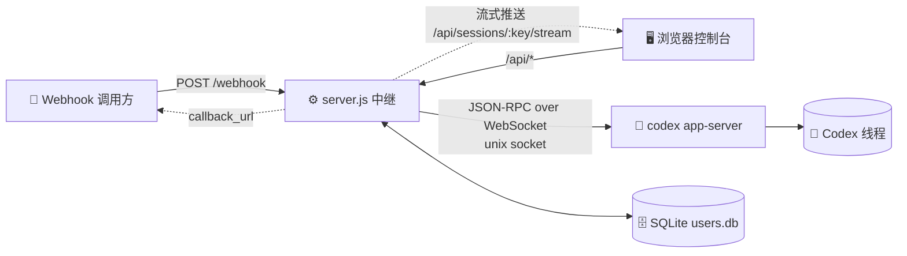

<p align="center"></p>

<h1 align="center">💬 linebot-relay</h1>

<p align="center"><b>把 Webhook 和网页控制台接到你已有的 Codex 会话上：看消息、发消息，仅此而已。</b></p>

<p align="center">
  <b>简体中文</b> · <a href="README.en.md">English</a>
</p>

<p align="center">
  
  
  
  
  
  
</p>

---

## ✨ 功能亮点

- 🔗 **只关联已有 Codex 会话**：控制台和 Webhook 永远不会在 Codex 里新建线程，ID 不存在直接 404
- ⚡ **流式输出**：回复、思考过程、命令输出边生成边推送（流式 HTTP + 15 秒心跳，断线时 3 秒轮询兜底）
- 👥 **用户与权限**：SQLite 存用户，超级管理员决定谁能看哪些会话
- 🖼️ **图片显示**：AI 生成的图片通过签名链接安全展示，点击放大
- 📎 **附件上传**：消息可附带文件（默认最多 5 个、单个 20 MB）
- 📝 **Markdown 渲染**：marked + DOMPurify，安全又好看
- 🧵 **排队与并发**：同一会话串行排队，全局并发上限可配
- 🔔 **异步回调**：Webhook 可带 `callback_url`，完成后回推结果
- 🌗 **Vue 3 控制台**：极简黑白灰，深浅色、手机端都适配
- 🪶 **后端零 npm 依赖**：纯 Node 22 内置模块（`node:sqlite`），`better-sqlite3` 仅作可选后备

## 🏗️ 架构



## 🔐 角色与权限

| 能力 | 👑 超级管理员 | 🙋 普通用户 |
|---|:---:|:---:|
| 关联 Codex **已有**会话 | ✅ | ❌ |
| 删除会话（仅控制台记录，不动 Codex） | ✅ | ❌ |
| 给用户分配会话 | ✅ | ❌ |
| 用户增删改、重置密码 | ✅ | ❌ |
| 查看 Webhook Token / 全局统计 | ✅ | ❌ |
| 查看分到的会话、发消息 | ✅ | ✅ |
| 修改自己的密码 | ✅ | ✅ |
| 在 Codex 里新建会话 | 🚫 | 🚫 |

> 💡 未分配的会话对普通用户一律返回 404，像不存在一样。`WEBHOOK_TOKEN` 本身拥有管理员权限，也可作为控制台的应急登录。

## 🚀 快速开始

```sh
# 1️⃣ 准备环境：Node 22+，并且本机有在跑的 codex app-server
git clone https://github.com/dylantsai-dev/linebot-relay.git
cd linebot-relay

# 2️⃣ 配置
cp .env.example .env      # 至少填 WEBHOOK_TOKEN

# 3️⃣ 构建前端
cd web && npm ci && npm run build && cd ..

# 4️⃣ 启动
set -a; . ./.env; set +a
npm start                 # 默认 http://127.0.0.1:8790/console
```

首次打开控制台，如果还没有管理员，会提示用 `WEBHOOK_TOKEN` 登录并创建管理员（也可以用 `ADMIN_USERNAME` / `ADMIN_PASSWORD` 预置）。

## ⚙️ 环境变量

| 变量 | 默认值 | 说明 |
|---|---|---|
| `WEBHOOK_TOKEN` | — **必填** | Webhook 的 Bearer Token，同时是超级管理员密钥 |
| `PORT` | `8790` | 监听端口 |
| `HOST` | `127.0.0.1` | 监听地址 |
| `CODEX_APP_SERVER_SOCK` | — | codex app-server 控制 socket 路径 |
| `CODEX_HOME` | `/root/.codex` | Codex 数据目录（校验会话、读取图片） |
| `CODEX_BIN` | `/root/.local/bin/codex` | Codex CLI 路径 |
| `CODEX_MODEL` | — | 指定模型（可选） |
| `CODEX_TIMEOUT_MS` | `600000` | 单次运行超时 |
| `MAX_CONCURRENCY` | `2` | 全局并发上限 |
| `MAX_FILES` / `MAX_FILE_BYTES` | `5` / `20971520` | 附件数量与单个大小上限 |
| `DATA_DIR` | `/opt/linebot-relay/data` | 会话、历史、用户库 |
| `WORK_DIR` / `LOG_DIR` / `UPLOAD_DIR` | `/opt/linebot-relay/{work,logs,uploads}` | 工作、日志、上传目录 |
| `USERS_DB` | `$DATA_DIR/users.db` | SQLite 用户库路径 |
| `SQLITE_DRIVER` | 自动 | 强制 `node:sqlite` 或 `better-sqlite3` |
| `ADMIN_USERNAME` / `ADMIN_PASSWORD` | — | 首个管理员预置（已有管理员时忽略） |
| `CONSOLE_DIST` | `web/dist` | 前端构建目录 |
| `CONSOLE_UI` | — | 设为 `legacy` 使用旧版单文件控制台 |

## 🛣️ API 一览

| 方法 | 路径 | 权限 | 说明 |
|---|---|---|---|
| `POST` | `/webhook` | Token | 发消息到会话（可带附件、`callback_url`） |
| `POST` | `/api/send` | 登录 | 控制台发消息 |
| `GET` | `/sessions` | Token | 会话列表（旧接口） |
| `GET` | `/health` | 公开 | 健康检查 |
| `GET` | `/api/auth/status` | 公开 | 是否需要初始化 |
| `POST` | `/api/auth/login` · `logout` · `password` · `setup` | — / 登录 | 登录、退出、改密、初始化管理员 |
| `GET` | `/api/whoami` | 登录 | 当前身份 |
| `GET` | `/api/sessions` | 登录 | 可见会话 |
| `PUT` | `/api/sessions/:key` | 👑 | 关联 Codex 已有会话 |
| `DELETE` | `/api/sessions/:key` | 👑 | 删除会话 |
| `GET` | `/api/sessions/:key/history` | 已授权 | 历史消息 |
| `GET` | `/api/sessions/:key/stream` | 已授权 | 流式推送 |
| `GET` | `/api/codex/threads` | 👑 | Codex 已有会话列表 |
| `GET` | `/api/media/...` | 签名链接 | 图片 |
| `GET` | `/api/files` · `/api/requests` · `/api/stats` | 登录 | 文件、请求日志、统计 |
| `GET` | `/api/webhook-token` | 👑 | 获取 Token（生成 curl 用） |
| `GET/POST` | `/api/users` | 👑 | 用户列表 / 新建 |
| `GET/PATCH/DELETE` | `/api/users/:id` | 👑 | 用户详情 / 修改 / 删除 |
| `PUT` | `/api/users/:id/sessions` | 👑 | 设置会话授权 |
| `POST` | `/api/users/:id/password` | 👑 | 重置密码 |

示例：

```sh
curl -X POST http://127.0.0.1:8790/webhook \
  -H "Authorization: Bearer $WEBHOOK_TOKEN" \
  -H 'Content-Type: application/json' \
  -d '{"session":"my-session","message":"你好 👋"}'
```

## 🗂️ 项目结构

```text
linebot-relay/
├── server.js               # ⚙️ HTTP 服务、路由、排队、权限
├── lib/
│   ├── appserver.js        # 🧠 codex app-server JSON-RPC 客户端
│   ├── ws-unix.js          # 🔌 unix socket 上的 WebSocket
│   ├── users.js            # 👥 SQLite 用户 / 授权 / Token
│   ├── media.js            # 🖼️ 签名图片链接
│   └── attachments.js      # 📎 附件解析
├── web/                    # 🌗 Vue 3 + Vite + TS 控制台
│   └── src/ (App.vue, components/, store.ts, brand/mark.svg)
├── console.html            # 🗃️ 旧版单文件控制台
├── test/                   # 🧪 测试（含 fake app-server）
├── linebot-relay.service   # 🐧 systemd 单元
└── .env.example
```

## 🐧 部署

1. 代码放到 `/opt/linebot-relay`，安装 **Node 22**（需要 `node:sqlite`）
2. 写好 `/opt/linebot-relay/.env`，`chmod 600`
3. `cd web && npm ci && npm run build`
4. 安装服务：

```sh
cp linebot-relay.service /etc/systemd/system/
systemctl daemon-reload
systemctl enable --now linebot-relay
```

5. 建议只监听 `127.0.0.1`，前面放 HTTPS 反向代理（Nginx / Caddy 等）

> ⚠️ 中继只连接已在运行的 codex app-server，重启中继不会影响 Codex 本身。

## 🛡️ 安全

- 🔑 密码用 **scrypt** 哈希；登录 Token 30 天有效，可撤销
- 🚦 15 分钟内失败 10 次即锁定（计数在内存，重启服务清零）
- 🙈 越权访问返回 404/403，不泄露会话是否存在
- 🖼️ 图片走签名链接，校验授权，拦截路径穿越和符号链接
- 🧱 控制台带严格 CSP、`nosniff`、`frame-ancestors 'none'`
- 🗄️ `users.db` 权限 600；切勿提交 `.env`

## 🧪 开发与测试

```sh
npm test                  # 运行 test/run-tests.sh（后端 + 用户 + app-server 模拟）

cd web
npm run dev               # Vite 开发服务器（http://localhost:5173）
npm run typecheck         # vue-tsc 类型检查
```

---

<p align="center">Made with ☕ & 🤖</p>
