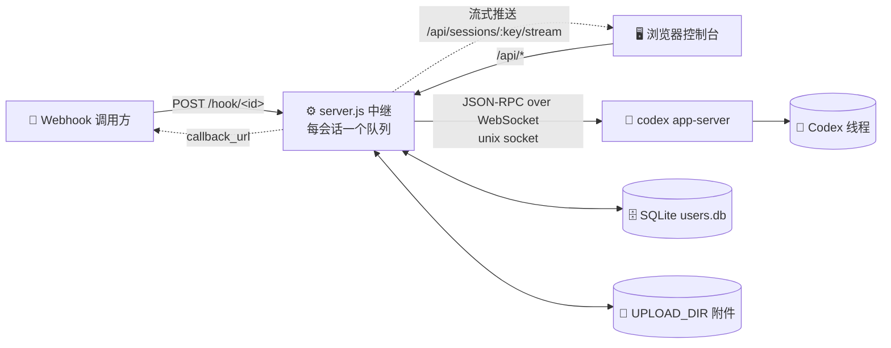
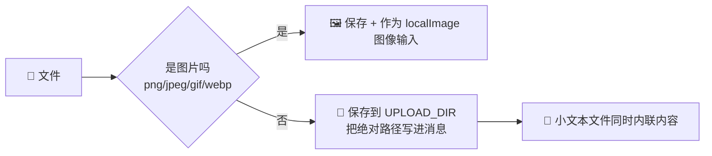

<p align="center"></p>

<h1 align="center">💬 linebot-relay</h1>

<p align="center"><b>把 Webhook 和网页控制台接到你已有的 Codex 会话上：看消息、发消息，仅此而已。</b></p>

<p align="center">
  <b>简体中文</b> · <a href="README.en.md">English</a> · <a href="README.ja.md">日本語</a> · <a href="README.es.md">Español</a> · <a href="README.fr.md">Français</a> · <a href="README.ru.md">Русский</a>
</p>

<p align="center">
  
  
  
  
  
  
</p>

---

## 🎯 为什么要做这个项目

Codex 是一个很强的智能体：它能读规则、调用 MCP 工具、加载技能、长期记住一个会话里的上下文。但它原本只在 **一个人的电脑上、一个人的 Codex App 里** 用。我们做日本电商客服，需要的是另一回事：

1. **让外部系统能把消息交给它。** LINE、店铺后台、订单系统这些地方来的消息，要能通过一个 HTTP 请求直接送进对应的 Codex 会话，再拿到回复。
2. **让很多人一起看、一起用，又不用每个人都装 Codex。** 客服、运营、主管在浏览器里打开控制台，就能看到会话里发生了什么，也能接着发消息。
3. **权限要收得住。** 每个人只看得到分给自己的会话，会话的增删和分配只有超级管理员能做，谁也不能借这个控制台在 Codex 里新建线程或乱开会话。

linebot-relay 就是中间这一层 **中继 + 控制台**：

- 🧵 **会话还是那个会话**：它只连接 Codex 里已经存在的线程，Codex App、Webhook、网页控制台看到的是同一份上下文，谁发的消息都会排进同一个队列，不会互相打架。
- 🪝 **每个会话一个独立入口**：每个会话有自己的 Webhook 地址和密钥，泄露一个只影响一个，随时可以重置；会话还可以一键「暂停接收」。
- 🖥️ **一个对外的、干净的界面**：控制台以「ディランボット 三代目」的品牌出现，终端用户只看到消息、文件、进度，看不到背后用的是什么引擎。
- 🧩 **它不是网页版 Codex**：不新建会话、不改 Codex 配置、不碰 Codex 进程，只负责「把消息送进去、把过程和结果拿出来、给对的人看」。

一句话：**让一个已经调教好的 Codex 智能体，能被业务系统调用、被团队安全地共同使用。**

---

## ✨ 功能亮点

- 🔗 **只关联已有 Codex 会话**：控制台和 Webhook 永远不会在 Codex 里新建线程，ID 不存在直接 404
- ⚡ **流式输出**：回复、思考过程、命令输出边生成边推送（流式 HTTP + 15 秒心跳，断线时 3 秒轮询兜底）
- 🔄 **刷新不丢任务**：地址栏带 `#s=<会话名>`，刷新后自动回到该会话，正在跑的回合显示「运行中」并继续实时输出
- ⏹️ **一键停止**：运行中可点「停止」，通过 app-server `turn/interrupt` 中断当前回合
- 🚦 **排队 / 引导**：AI 忙时发消息可选「排队」（等当前回合结束再发）或「引导」（`turn/steer` 直接插进正在跑的回合）
- 📎 **任意文件上传**：图片作为图像输入交给 Codex，其他文件保存到服务器并把绝对路径告诉 Codex；支持拖拽、粘贴、多选
- ⬇️ **文件下载卡片**：消息里的附件显示为文件卡片，走签名链接下载
- 🪝 **每个会话一个 Webhook**：`POST /hook/<id>` + 会话自己的 `dbk_` 密钥，地址决定会话；管理员可在控制台查看、复制 curl、重置密钥；`mode` 选排队 / 引导，支持 multipart 传文件
- ⏸️ **暂停接收**：管理员可在会话旁一键暂停，暂停期间 Webhook 返回 `423`「该会话已暂停接收」，控制台照常可发
- 👥 **用户与权限**：SQLite 存用户，超级管理员决定谁能看哪些会话
- 🖼️ **图片显示**：AI 生成的图片通过签名链接安全展示，点击放大
- 📝 **Markdown 渲染**：marked + DOMPurify，安全又好看
- 🔔 **异步回调**：Webhook 可带 `callback_url`，完成后回推结果
- 🌗 **Vue 3 控制台**：深浅色、手机端都适配
- 🪶 **后端零 npm 依赖**：纯 Node 22 内置模块（`node:sqlite`），`better-sqlite3` 仅作可选后备

## 🏗️ 架构



## 🚦 排队 vs 引导

| 模式 | 🧵 AI 空闲时 | 🏃 AI 正在跑回合时 |
|---|---|---|
| 📥 **排队** `queue`（默认） | 立即作为新回合发送 | 进入该会话的队列，当前回合结束后按顺序发送 |
| 🧭 **引导** `steer` | 插到队列最前面，马上发送 | 调用 `turn/steer`（带 `expectedTurnId`）直接注入正在跑的回合 |

- 🛟 **兜底**：引导时如果没有正在跑的回合，或 Codex 拒绝了 steer，消息会自动改为排在队首发送，响应里会带 `steer_fallback`（`no_active_turn` / `steer_rejected`）
- 🗂️ 排队中的消息在控制台里可见，还没发出去的可以撤回（普通用户只能撤回自己的）
- 🔁 不管回合是谁发起的（控制台、Webhook 还是 Codex App 本身），排队消息都会等线程空闲再发

## 📎 文件上传



- 🖱️ 控制台：点回形针、拖拽到窗口、或直接 `Ctrl/⌘+V` 粘贴
- 🪝 Webhook：`multipart/form-data`（字段名 `file` 或 `files`），或 JSON 里的 `files: [{name, content_base64, mime}]` / `file_urls: [...]`
- 📏 默认限制：单个 **50 MB**、最多 **10** 个、合计 **100 MB**（见环境变量）
- 🔏 历史里的附件显示为文件卡片，通过有时效的签名链接下载

## 🔐 角色与权限

| 能力 | 👑 超级管理员 | 🙋 普通用户 |
|---|:---:|:---:|
| 关联 Codex **已有**会话 | ✅ | ❌ |
| 删除会话（仅控制台记录，不动 Codex） | ✅ | ❌ |
| 给用户分配会话 | ✅ | ❌ |
| 用户增删改、重置密码 | ✅ | ❌ |
| 查看 / 重置会话 Webhook、暂停接收、全局统计 | ✅ | ❌ |
| 查看分到的会话、发消息、上传文件 | ✅ | ✅ |
| 排队 / 引导 / 停止回合（分到的会话） | ✅ | ✅ |
| 撤回排队中的消息 | ✅ 全部 | ✅ 仅自己的 |
| 修改自己的密码 | ✅ | ✅ |
| 在 Codex 里新建会话 | 🚫 | 🚫 |

> 💡 未分配的会话对普通用户一律返回 404，像不存在一样。`WEBHOOK_TOKEN` 本身拥有管理员权限，也可作为控制台的应急登录。

## 🚀 快速开始

```sh
# 1️⃣ 准备环境：Node 22+，并且本机有在跑的 codex app-server
git clone https://github.com/dylantsai-dev/linebot-relay.git
cd linebot-relay

# 2️⃣ 配置
cp .env.example .env      # 至少填 WEBHOOK_TOKEN

# 3️⃣ 构建前端
cd web && npm ci && npm run build && cd ..

# 4️⃣ 启动
set -a; . ./.env; set +a
npm start                 # 默认 http://127.0.0.1:8790/console
```

首次打开控制台，如果还没有管理员，会提示用 `WEBHOOK_TOKEN` 登录并创建管理员（也可以用 `ADMIN_USERNAME` / `ADMIN_PASSWORD` 预置）。

## ⚙️ 环境变量

| 变量 | 默认值 | 说明 |
|---|---|---|
| `WEBHOOK_TOKEN` | — **必填** | 超级管理员密钥（初始化和应急登录用）；不再用于发 Webhook |
| `PORT` | `8790` | 监听端口 |
| `HOST` | `127.0.0.1` | 监听地址 |
| `CODEX_APP_SERVER_SOCK` | — | codex app-server 控制 socket 路径 |
| `CODEX_HOME` | `/root/.codex` | Codex 数据目录（校验会话、读取图片） |
| `CODEX_BIN` | `/root/.local/bin/codex` | Codex CLI 路径 |
| `CODEX_MODEL` | — | 指定模型（可选） |
| `CODEX_TIMEOUT_MS` | `600000` | 单次运行超时 |
| `MAX_CONCURRENCY` | `2` | 全局并发上限 |
| `MAX_FILE_BYTES` | `52428800`（50 MB） | 单个文件大小上限 |
| `MAX_FILES` | `10` | 每条消息最多文件数 |
| `MAX_TOTAL_BYTES` | `104857600`（100 MB） | 每条消息文件总大小上限 |
| `DATA_DIR` | `/opt/linebot-relay/data` | 会话、历史、用户库 |
| `WORK_DIR` / `LOG_DIR` / `UPLOAD_DIR` | `/opt/linebot-relay/{work,logs,uploads}` | 工作、日志、上传目录 |
| `USERS_DB` | `$DATA_DIR/users.db` | SQLite 用户库路径 |
| `SQLITE_DRIVER` | 自动 | 强制 `node:sqlite` 或 `better-sqlite3` |
| `ADMIN_USERNAME` / `ADMIN_PASSWORD` | — | 首个管理员预置（已有管理员时忽略） |
| `CONSOLE_DIST` | `web/dist` | 前端构建目录 |
| `CONSOLE_UI` | — | 设为 `legacy` 使用旧版单文件控制台 |

## 🛣️ API 一览

| 方法 | 路径 | 权限 | 说明 |
|---|---|---|---|
| `POST` | `/hook/:id` | 会话密钥 | 发消息到这个会话，`mode` = `queue`（默认）/ `steer`；暂停时返回 `423` |
| `POST` | `/webhook` · `/webhook/queue` · `/webhook/steer` | — | 🚫 已停用，返回 `410` |
| `POST` | `/api/send` | 登录 | 控制台发消息；`async=1` 立即返回 202（`id`、`status`、`position`），之后走流式推送 |
| `GET` | `/sessions` | Token | 会话列表（旧接口） |
| `GET` | `/health` | 公开 | 健康检查 |
| `GET` | `/api/auth/status` | 公开 | 是否需要初始化 |
| `POST` | `/api/auth/login` · `logout` · `password` · `setup` | — / 登录 | 登录、退出、改密、初始化管理员 |
| `GET` | `/api/whoami` | 登录 | 当前身份 |
| `GET` | `/api/sessions` | 登录 | 可见会话（含 `running` / `queued` 状态） |
| `PUT` | `/api/sessions/:key` | 👑 | 关联 Codex 已有会话 |
| `PATCH` | `/api/sessions/:key` | 👑 | 改名、`paused: true/false` 暂停或恢复接收 |
| `DELETE` | `/api/sessions/:key` | 👑 | 删除会话 |
| `GET` | `/api/sessions/:key/webhook` | 👑 | 查看会话 Webhook 地址和密钥 |
| `POST` | `/api/sessions/:key/webhook/rotate` | 👑 | 重置密钥（地址不变，旧密钥立即失效） |
| `GET` | `/api/sessions/:key/history` | 已授权 | 历史消息（含附件），分页：`limit`（默认 50）、`before=<ISO 时间>`，返回 `has_more` 和待处理的 `prompts` |
| `POST` | `/api/sessions/:key/prompts/:id` | 已授权 | 回答审批 / 提问卡片：`{decision}` 或 `{answers}` |
| `GET` | `/api/sessions/:key/stream` | 已授权 | 流式推送（快照 + 增量，刷新后可接上运行中的回合） |
| `GET` | `/api/sessions/:key/queue` | 已授权 | 当前队列（运行中 / 已引导 / 排队中） |
| `DELETE` | `/api/sessions/:key/queue/:id` | 已授权 | 撤回还没发出的排队消息 |
| `POST` | `/api/sessions/:key/interrupt` | 已授权 | ⏹️ 停止正在运行的回合 |
| `GET` | `/api/codex/threads` | 👑 | Codex 已有会话列表 |
| `GET` | `/api/media/...` | 签名链接 | 图片预览 / 附件下载 |
| `GET` | `/api/files` · `/api/requests` · `/api/stats` | 登录 | 文件、请求日志、统计 |
| `GET` | `/api/webhook-token` | 👑 | 获取 Token（生成 curl 用） |
| `GET/POST` | `/api/users` | 👑 | 用户列表 / 新建 |
| `GET/PATCH/DELETE` | `/api/users/:id` | 👑 | 用户详情 / 修改 / 删除 |
| `PUT` | `/api/users/:id/sessions` | 👑 | 设置会话授权 |
| `POST` | `/api/users/:id/password` | 👑 | 重置密码 |

### 🧪 Webhook 示例

```sh
# 💬 排队（默认），同步等回复
# 地址和密钥在控制台「会话 → Webhook」里复制
curl -X POST "$HOOK_URL" \
  -H "Authorization: Bearer $HOOK_KEY" \
  -H 'Content-Type: application/json' \
  -d '{"message":"你好 👋"}'

# 🧭 引导：插进正在跑的回合
curl -X POST "$HOOK_URL" \
  -H "Authorization: Bearer $HOOK_KEY" \
  -H 'Content-Type: application/json' \
  -d '{"message":"顺便把测试也跑一下","mode":"steer"}'

# 📎 带文件（multipart），完成后回调
curl -X POST "$HOOK_URL" \
  -H "Authorization: Bearer $HOOK_KEY" \
  -F message='帮我看看这两个文件' \
  -F callback_url=https://example.com/callback \
  -F file=@report.pdf \
  -F file=@screenshot.png
```

> 🔔 带 `callback_url` 时立即返回 `202 {accepted, id, mode}`，跑完后把结果 POST 到回调地址；不带时同步等待回复。

## 🗂️ 项目结构

```text
linebot-relay/
├── server.js               # ⚙️ HTTP 服务、路由、排队 / 引导、权限
├── lib/
│   ├── appserver.js        # 🧠 codex app-server JSON-RPC 客户端
│   ├── ws-unix.js          # 🔌 unix socket 上的 WebSocket
│   ├── users.js            # 👥 SQLite 用户 / 授权 / Token
│   ├── media.js            # 🖼️ 签名图片链接
│   └── attachments.js      # 📎 附件解析（multipart / base64 / URL）
├── web/                    # 🌗 Vue 3 + Vite + TS 控制台
│   └── src/ (App.vue, components/, store.ts, brand/mark.svg)
├── console.html            # 🗃️ 旧版单文件控制台
├── test/                   # 🧪 测试（含 fake app-server）
├── linebot-relay.service   # 🐧 systemd 单元
└── .env.example
```

## 🐧 部署

1. 代码放到 `/opt/linebot-relay`，安装 **Node 22**（需要 `node:sqlite`）
2. 写好 `/opt/linebot-relay/.env`，`chmod 600`
3. `cd web && npm ci && npm run build`
4. 安装服务：

```sh
cp linebot-relay.service /etc/systemd/system/
systemctl daemon-reload
systemctl enable --now linebot-relay
```

5. 建议只监听 `127.0.0.1`，前面放 HTTPS 反向代理（Nginx / Caddy 等）

> ⚠️ 中继只连接已在运行的 codex app-server，重启中继不会影响 Codex 本身。

## 🛡️ 安全

- 🔑 密码用 **scrypt** 哈希；登录 Token 30 天有效，可撤销
- 🚦 15 分钟内失败 10 次即锁定（计数在内存，重启服务清零）
- 🙈 越权访问返回 404/403，不泄露会话是否存在
- 🖼️ 图片走签名链接，校验授权，拦截路径穿越和符号链接
- 🧱 控制台带严格 CSP、`nosniff`、`frame-ancestors 'none'`
- 🗄️ `users.db` 权限 600；切勿提交 `.env`

## 🧪 开发与测试

```sh
npm test                  # 运行 test/run-tests.sh（后端 + 用户 + app-server 模拟）

cd web
npm run dev               # Vite 开发服务器（http://localhost:5173）
npm run typecheck         # vue-tsc 类型检查
```

---

<p align="center">Made with ☕ & 🤖</p>
