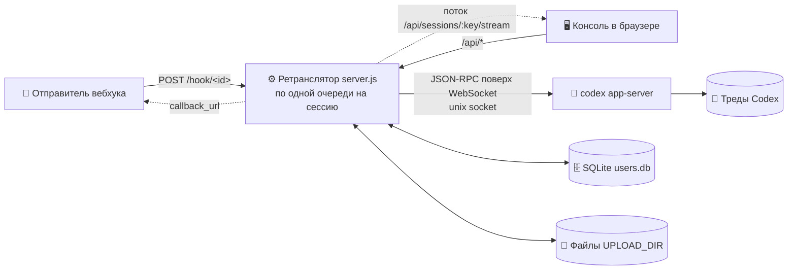
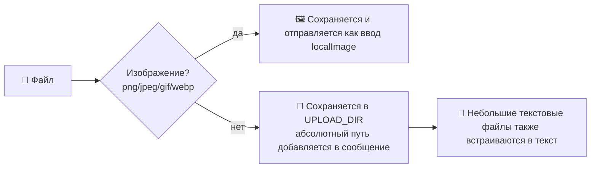

<p align="center"></p>

<h1 align="center">💬 linebot-relay</h1>

<p align="center"><b>Подключает вебхуки и веб-консоль к уже существующим тредам Codex: читать сообщения, отправлять сообщения, и ничего больше.</b></p>

<p align="center">
  <a href="README.md">简体中文</a> · <a href="README.en.md">English</a> · <a href="README.ja.md">日本語</a> · <a href="README.es.md">Español</a> · <a href="README.fr.md">Français</a> · <b>Русский</b>
</p>

<p align="center">
  
  
  
  
  
  
</p>

---

## 🎯 Зачем нужен этот проект

Codex — способный агент: он читает правила, вызывает инструменты MCP, загружает навыки и хранит долгий контекст внутри треда. Но «из коробки» он живёт **на компьютере одного человека, в приложении Codex одного человека**. Для поддержки клиентов японского интернет-магазина нам было нужно другое:

1. **Внешние системы должны передавать ему сообщения.** Сообщения из LINE, админки магазина или системы заказов должны попадать в нужный тред Codex одним HTTP-запросом, а ответ — возвращаться обратно.
2. **Многим людям нужно следить за ним и пользоваться им, не устанавливая Codex каждому.** Поддержка, операционная команда и руководители открывают консоль в браузере, видят, что произошло в треде, и продолжают разговор.
3. **Доступ должен оставаться строгим.** Каждый видит только назначенные ему треды; добавлять, удалять и назначать треды может только суперадминистратор, и никто не может создать через консоль новый тред Codex.

linebot-relay и есть этот промежуточный слой — **ретранслятор с консолью**:

- 🧵 **Тот же тред, тот же контекст**: подключается только к тредам, которые уже есть в Codex. Приложение Codex, вебхуки и веб-консоль делят один контекст, и все сообщения попадают в одну очередь треда, поэтому они никогда не сталкиваются.
- 🪝 **Одна точка входа на тред**: у каждого треда свой URL вебхука и свой ключ. Утёкший ключ затрагивает только один тред и может быть сброшен в любой момент, а тред можно приостановить одним щелчком.
- 🖥️ **Чистый интерфейс для внешних пользователей**: консоль выходит под брендом 「ディランボット 三代目」. Конечные пользователи видят сообщения, файлы и прогресс, а не движок за ними.
- 🧩 **Это не веб-версия Codex**: он никогда не создаёт треды, не меняет конфигурацию Codex и не трогает его процесс. Он только передаёт сообщения внутрь, выносит наружу прогресс и результаты и показывает их нужным людям.

Одной фразой: **позволить уже настроенному агенту Codex вызываться бизнес-системами и безопасно использоваться всей командой.**

---

## ✨ Возможности

- 🔗 **Только существующие треды Codex**: консоль и вебхуки никогда не создают треды Codex; на неизвестные ID возвращается 404
- ⚡ **Потоковая передача в реальном времени**: ответы, рассуждения и вывод команд отправляются по мере генерации (потоковый HTTP + heartbeat каждые 15 с, резервный опрос каждые 3 с)
- 🔄 **Перезагрузка не страшна**: в URL есть `#s=<session>`, поэтому после перезагрузки вы возвращаетесь в ту же сессию, а выполняющийся ход продолжает транслироваться с пометкой «运行中» (выполняется)
- ⏹️ **Кнопка остановки**: прерывает текущий ход через `turn/interrupt` app-server
- 🚦 **Очередь / подсказка**: пока ИИ занят, выберите 排队 (очередь: отправить после текущего хода) или 引导 (подсказка: вставить в текущий ход через `turn/steer`)
- 📎 **Любые типы файлов**: изображения передаются в Codex как графический ввод; остальные файлы сохраняются на сервере, а их абсолютные пути передаются Codex. Поддерживаются перетаскивание, вставка и множественный выбор
- ⬇️ **Плашки для скачивания**: вложения в истории отображаются как плашки файлов с подписанными ссылками для скачивания
- 🪝 **Один вебхук на тред**: `POST /hook/<id>` с собственным ключом треда `dbk_`; тред определяется URL. Администраторы смотрят его, копируют curl и сбрасывают ключ в консоли; `mode` выбирает очередь / подсказку; поддерживается загрузка multipart
- ⏸️ **Приостановка приёма**: администраторы приостанавливают тред одним щелчком; на время паузы его вебхук возвращает `423`, а из консоли по-прежнему можно отправлять
- 👥 **Пользователи и права**: на основе SQLite; суперадминистратор решает, кто какие сессии видит
- 🖼️ **Изображения**: изображения, созданные ИИ, показываются по подписанным URL, щелчок — увеличение
- 📝 **Markdown**: marked + DOMPurify
- 🔔 **Асинхронные колбэки**: вебхук может передать `callback_url`, чтобы получить результат
- 🌗 **Консоль на Vue 3**: светлая и тёмная темы, адаптация под мобильные
- 🪶 **Ноль npm-зависимостей на бэкенде**: встроенные модули Node 22 (`node:sqlite`), `better-sqlite3` — необязательный запасной вариант

## 🏗️ Архитектура



## 🚦 Очередь и подсказка

| Режим | 🧵 ИИ свободен | 🏃 ИИ выполняет ход |
|---|---|---|
| 📥 **Очередь** `queue` (по умолчанию) | Сразу отправляется как новый ход | Ждёт в очереди сессии и отправляется по порядку после текущего хода |
| 🧭 **Подсказка** `steer` | Встаёт в начало очереди и сразу отправляется | Вставляется в текущий ход через `turn/steer` (с `expectedTurnId`) |

- 🛟 **Запасные варианты**: если выполняющегося хода нет или Codex отклоняет подсказку, сообщение отправляется следующим из начала очереди, а в ответе есть `steer_fallback` (`no_active_turn` / `steer_rejected`)
- 🗂️ Сообщения в очереди видны в консоли, и их можно отозвать до отправки (обычные пользователи — только свои)
- 🔁 Кто бы ни начал текущий ход (консоль, вебхук или само приложение Codex), сообщения в очереди ждут, пока тред не освободится

## 📎 Загрузка файлов



- 🖱️ Консоль: кнопка-скрепка, перетаскивание в окно или вставка через `Ctrl/⌘+V`
- 🪝 Вебхук: `multipart/form-data` (поле `file` или `files`) или JSON `files: [{name, content_base64, mime}]` / `file_urls: [...]`
- 📏 Ограничения по умолчанию: **50 МБ** на файл, **10** файлов, **100 МБ** всего (см. переменные окружения)
- 🔏 Вложения в истории отображаются как плашки файлов и скачиваются по кратковременным подписанным ссылкам

## 🔐 Роли и права

| Возможность | 👑 Суперадминистратор | 🙋 Пользователь |
|---|:---:|:---:|
| Привязать **существующий** тред Codex | ✅ | ❌ |
| Удалить сессию (только запись в консоли, Codex не затрагивается) | ✅ | ❌ |
| Назначать сессии пользователям | ✅ | ❌ |
| Управлять пользователями, сбрасывать пароли | ✅ | ❌ |
| Просматривать / сбрасывать вебхуки тредов, приостанавливать приём, общая статистика | ✅ | ❌ |
| Читать назначенные сессии, отправлять сообщения, загружать файлы | ✅ | ✅ |
| Очередь / подсказка / остановка ходов (назначенные сессии) | ✅ | ✅ |
| Отзывать сообщения из очереди | ✅ все | ✅ только свои |
| Менять собственный пароль | ✅ | ✅ |
| Создавать треды в Codex | 🚫 | 🚫 |

> 💡 Для обычных пользователей неназначенные сессии возвращают 404, как будто их не существует. `WEBHOOK_TOKEN` обладает правами администратора и также служит аварийным входом в консоль.

## 🚀 Быстрый старт

```sh
# 1️⃣ Требования: Node 22+ и запущенный codex app-server
git clone https://github.com/dylantsai-dev/linebot-relay.git
cd linebot-relay

# 2️⃣ Настройка
cp .env.example .env      # задайте как минимум WEBHOOK_TOKEN

# 3️⃣ Сборка консоли
cd web && npm ci && npm run build && cd ..

# 4️⃣ Запуск
set -a; . ./.env; set +a
npm start                 # http://127.0.0.1:8790/console
```

При первом входе, если администратора ещё нет, войдите с `WEBHOOK_TOKEN` и создайте его (или создайте заранее через `ADMIN_USERNAME` / `ADMIN_PASSWORD`).

## ⚙️ Переменные окружения

| Переменная | По умолчанию | Описание |
|---|---|---|
| `WEBHOOK_TOKEN` | — **обязательна** | Ключ суперадминистратора (первичная настройка и аварийный вход); для отправки вебхуков больше не используется |
| `PORT` | `8790` | Порт прослушивания |
| `HOST` | `127.0.0.1` | Адрес прослушивания |
| `CODEX_APP_SERVER_SOCK` | — | Управляющий сокет codex app-server |
| `CODEX_HOME` | `/root/.codex` | Каталог данных Codex (проверка тредов, изображения) |
| `CODEX_BIN` | `/root/.local/bin/codex` | Путь к Codex CLI |
| `CODEX_MODEL` | — | Переопределение модели (необязательно) |
| `CODEX_TIMEOUT_MS` | `600000` | Тайм-аут одного запуска |
| `MAX_CONCURRENCY` | `2` | Общий предел параллельности |
| `MAX_FILE_BYTES` | `52428800` (50 МБ) | Максимальный размер одного файла |
| `MAX_FILES` | `10` | Максимум файлов в сообщении |
| `MAX_TOTAL_BYTES` | `104857600` (100 МБ) | Максимальный общий размер файлов в сообщении |
| `DATA_DIR` | `/opt/linebot-relay/data` | Сессии, история, база пользователей |
| `WORK_DIR` / `LOG_DIR` / `UPLOAD_DIR` | `/opt/linebot-relay/{work,logs,uploads}` | Рабочий каталог, журналы и загрузки |
| `USERS_DB` | `$DATA_DIR/users.db` | Путь к базе пользователей SQLite |
| `SQLITE_DRIVER` | auto | Принудительно `node:sqlite` или `better-sqlite3` |
| `ADMIN_USERNAME` / `ADMIN_PASSWORD` | — | Создать первого администратора (игнорируется, если он уже есть) |
| `CONSOLE_DIST` | `web/dist` | Каталог собранной консоли |
| `CONSOLE_UI` | — | Значение `legacy` включает старую однофайловую консоль |

## 🛣️ API

| Метод | Путь | Авторизация | Описание |
|---|---|---|---|
| `POST` | `/hook/:id` | Ключ треда | Отправить в этот тред, `mode` = `queue` (по умолчанию) / `steer`; `423` во время паузы |
| `POST` | `/webhook` · `/webhook/queue` · `/webhook/steer` | — | 🚫 Выведены из употребления, возвращают `410` |
| `POST` | `/api/send` | Вход | Отправка из консоли; `async=1` сразу возвращает 202 (`id`, `status`, `position`), дальше следите за потоком |
| `GET` | `/sessions` | Токен | Список сессий (устаревший) |
| `GET` | `/health` | Публично | Проверка состояния |
| `GET` | `/api/auth/status` | Публично | Нужна ли первичная настройка |
| `POST` | `/api/auth/login` · `logout` · `password` · `setup` | — / Вход | Вход, выход, смена пароля, создание первого администратора |
| `GET` | `/api/whoami` | Вход | Текущая учётная запись |
| `GET` | `/api/sessions` | Вход | Видимые сессии (с состоянием `running` / `queued`) |
| `PUT` | `/api/sessions/:key` | 👑 | Привязать существующий тред Codex |
| `PATCH` | `/api/sessions/:key` | 👑 | Переименовать; `paused: true/false` приостанавливает или возобновляет приём |
| `DELETE` | `/api/sessions/:key` | 👑 | Удалить сессию |
| `GET` | `/api/sessions/:key/webhook` | 👑 | Посмотреть URL вебхука и ключ треда |
| `POST` | `/api/sessions/:key/webhook/rotate` | 👑 | Сбросить ключ (URL тот же, старый ключ перестаёт работать) |
| `GET` | `/api/sessions/:key/history` | С доступом | История сообщений (с вложениями) |
| `GET` | `/api/sessions/:key/stream` | С доступом | Живой поток (снимок + изменения, возобновляет текущие ходы) |
| `GET` | `/api/sessions/:key/queue` | С доступом | Текущая очередь (running / steered / queued) |
| `DELETE` | `/api/sessions/:key/queue/:id` | С доступом | Отозвать ещё не отправленное сообщение из очереди |
| `POST` | `/api/sessions/:key/interrupt` | С доступом | ⏹️ Остановить текущий ход |
| `GET` | `/api/codex/threads` | 👑 | Существующие треды Codex |
| `GET` | `/api/media/...` | Подписанный URL | Просмотр изображения / скачивание файла |
| `GET` | `/api/files` · `/api/requests` · `/api/stats` | Вход | Файлы, журнал запросов, статистика |
| `GET` | `/api/webhook-token` | 👑 | Получить токен (для примеров curl) |
| `GET/POST` | `/api/users` | 👑 | Список / создание пользователей |
| `GET/PATCH/DELETE` | `/api/users/:id` | 👑 | Чтение / изменение / удаление пользователя |
| `PUT` | `/api/users/:id/sessions` | 👑 | Задать доступ к сессиям |
| `POST` | `/api/users/:id/password` | 👑 | Сбросить пароль |

### 🧪 Примеры вебхуков

```sh
# 💬 Очередь (по умолчанию), дождаться ответа
# Скопируйте URL и ключ из консоли: сессия → Webhook
curl -X POST "$HOOK_URL" \
  -H "Authorization: Bearer $HOOK_KEY" \
  -H 'Content-Type: application/json' \
  -d '{"message":"Привет 👋"}'

# 🧭 Подсказка в текущий ход
curl -X POST "$HOOK_URL" \
  -H "Authorization: Bearer $HOOK_KEY" \
  -H 'Content-Type: application/json' \
  -d '{"message":"Заодно запусти тесты","mode":"steer"}'

# 📎 С файлами (multipart) и колбэком
curl -X POST "$HOOK_URL" \
  -H "Authorization: Bearer $HOOK_KEY" \
  -F message='Проверь, пожалуйста, эти два файла' \
  -F callback_url=https://example.com/callback \
  -F file=@report.pdf \
  -F file=@screenshot.png
```

> 🔔 С `callback_url` вызов сразу возвращает `202 {accepted, id, mode}`, а по завершении отправляет результат POST-запросом на колбэк; без него вызов ждёт ответа.

## 🗂️ Структура проекта

```text
linebot-relay/
├── server.js               # ⚙️ HTTP-сервер, маршрутизация, очередь / подсказка, авторизация
├── lib/
│   ├── appserver.js        # 🧠 JSON-RPC-клиент codex app-server
│   ├── ws-unix.js          # 🔌 WebSocket поверх unix socket
│   ├── users.js            # 👥 пользователи / доступы / токены в SQLite
│   ├── media.js            # 🖼️ подписанные URL изображений
│   └── attachments.js      # 📎 разбор вложений (multipart / base64 / URL)
├── web/                    # 🌗 консоль на Vue 3 + Vite + TS
│   └── src/ (App.vue, components/, store.ts, brand/mark.svg)
├── console.html            # 🗃️ старая однофайловая консоль
├── test/                   # 🧪 тесты (вкл. поддельный app-server)
├── linebot-relay.service   # 🐧 юнит systemd
└── .env.example
```

## 🐧 Развёртывание

1. Поместите код в `/opt/linebot-relay` и установите **Node 22** (нужен `node:sqlite`)
2. Создайте `/opt/linebot-relay/.env` и выполните для него `chmod 600`
3. `cd web && npm ci && npm run build`
4. Установите сервис:

```sh
cp linebot-relay.service /etc/systemd/system/
systemctl daemon-reload
systemctl enable --now linebot-relay
```

5. Держите его на `127.0.0.1` за обратным HTTPS-прокси (Nginx, Caddy…)

> ⚠️ Ретранслятор лишь подключается к уже запущенному codex app-server; его перезапуск не влияет на Codex.

## 🛡️ Безопасность

- 🔑 Хеши паролей **scrypt**; отзываемые токены входа на 30 дней
- 🚦 Блокировка после 10 неудачных входов за 15 мин (в памяти, сбрасывается при перезапуске)
- 🙈 Неавторизованный доступ получает 404/403, не раскрывая, существует ли сессия
- 🖼️ Подписанные URL изображений с проверкой доступа; обход путей и символические ссылки блокируются
- 🧱 Строгий CSP, `nosniff`, `frame-ancestors 'none'` для консоли
- 🗄️ У `users.db` режим 600; никогда не коммитьте `.env`

## 🧪 Разработка и тестирование

```sh
npm test                  # запускает test/run-tests.sh

cd web
npm run dev               # dev-сервер Vite (http://localhost:5173)
npm run typecheck         # vue-tsc
```

---

<p align="center">Made with ☕ & 🤖</p>
